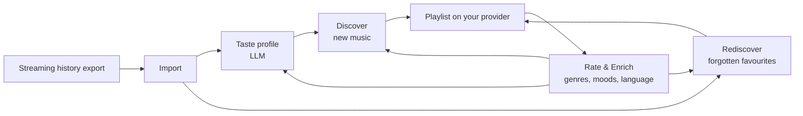

# MuseFlow

MuseFlow turns your own streaming history, exported through your GDPR right of access, into an AI taste profile. It then generates **discovery** playlists of music you don't know yet, and **rediscovery** playlists of forgotten favourites from your own past. You rate tracks in a feedback loop instead of letting an algorithm guess what you like.

It is a personal project and a showcase, built to explore a product idea end to end, not a hosted service.

Discovery asks an LLM for new tracks based on your taste profile. Rediscovery uses no LLM at generation time: it filters your own history by rating, genre, mood, language and listening dates.

-   **Product**

    ---

    Why it exists, the V1 → V2 pivot, lessons learned.

    [:octicons-arrow-right-24: Read the product story](product/index.md)

-   **User guide**

    ---

    Install, import your history, generate playlists.

    [:octicons-arrow-right-24: Get started](user-guide/index.md)

-   **Technical**

    ---

    Hexagonal architecture, LLM pipeline, testing.

    [:octicons-arrow-right-24: Explore the internals](technical/index.md)

-   **How this project is built with AI agents**

    ---

    Skills, subagents and conventions used to develop MuseFlow with Claude Code.

    [:octicons-arrow-right-24: AI-assisted development](technical/ai-assisted-development.md)

