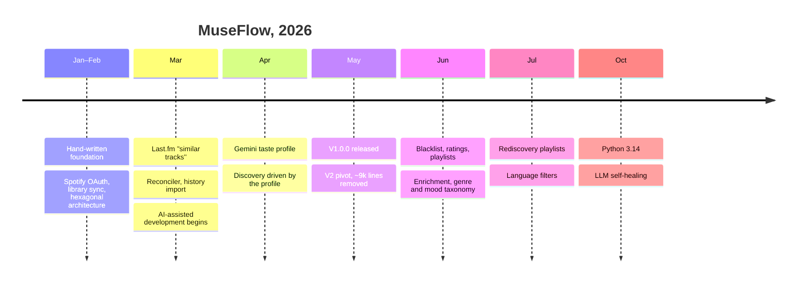
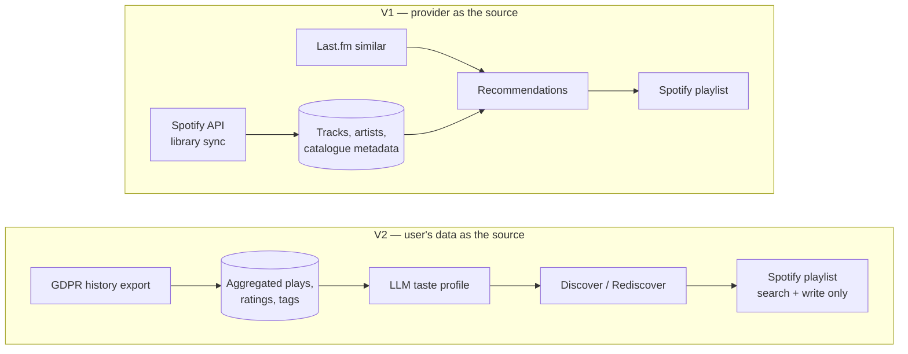

# The V1 → V2 pivot

The most important product decision in MuseFlow was not a feature. It was deciding **what the product should depend
on** — and realising I had picked the wrong thing.

## Timeline

## V1: sync everything through the provider's API

V1 (tagged `v1.0.0`) worked like most music side-projects:

- connect to Spotify with OAuth,
- **sync the user's library** through the API: top artists, top tracks, saved tracks, playlist tracks,
- ask **Last.fm** for "similar tracks" and, later, an LLM for suggestions,
- reconcile the suggestions against the Spotify catalogue and create a playlist.

It worked. It was also a great learning exercise: OAuth flows, pagination, rate limiting, a reconciler matching fuzzy
LLM output to real catalogue entries. But three problems kept growing.

**1. The provider owns the rules.** Spotify has been steadily restricting what third-party apps can access, and the
endpoints a recommendation side-project needs are exactly the ones that get cut. Every sync depended on a
dependency that could change its terms at any time — and did. A Spotify developer app is also capped in the number
of users it may serve until Spotify approves it, so even a working product could not grow without the provider's
blessing.

**2. Fragility and cost.** A full library sync means many paginated calls, rate limits, retries and partial failures.
A lot of engineering spent on *fetching* data rather than on *using* it. And the product was supposed to be
provider-agnostic, while in practice it was welded to one provider's API.

**3. The output was not good enough.** My own planning notes at the time say it plainly:

> *"The recommendation quality — 95% of generated tracks end up discarded — reveals that more API data doesn't
> translate to better music discovery."*

That third point was not what triggered the pivot (improving suggestions was already on the roadmap), but it removed
any temptation to defend V1's approach: more data from the API was not making the product better.

## The question that changed everything

Instead of asking *"what else can I get from the API?"*, I asked:

> **What can a music provider not take away from me?**

The answer: **my own data**. Under the GDPR (rights of access and data portability, articles 15 and 20), a provider
must hand over the personal data it holds about you. For Spotify, that includes the *extended streaming history*:
every play, with its timestamp and duration, going back to the creation of the account.

For a recommendation product, that file is gold. It is:

- **complete** — years of listening, not the last 50 top tracks an API is willing to return,
- **behavioural** — what I actually played, how long, when,
- **mine** — no API quota, no terms of service to renegotiate, no scope to be revoked,
- **portable** — every provider operating in the EU has to produce an equivalent export.

**It turned out I did not need to crawl the user's library at all. A history file is enough for the magic to happen.**

## V2: build on the user's data, use the provider only as an output

The V2 plan defined three pillars — **Import → Profile → Discover** — and one rule: *the taste profile is the central
artifact of the system; everything else serves it.*

What changed concretely:

| | V1 | V2 |
|---|---|---|
| Source of truth | Provider API (library sync) | User's GDPR history export |
| Provider role | Input **and** output | Output only (search + playlist write, a couple of calls per session) |
| Similarity engine | Last.fm + LLM | LLM driven by a persistent taste profile |
| Stored data | Tracks **and** artists tables, mirroring catalogue metadata (popularity, ISRC, duration, top positions…) | Slim track rows: aggregated plays (count, first/last played), ratings, genre/mood/language tags |
| Multi-provider | Impossible in practice | Possible by design: one import port per provider |

## What I threw away (and why that was fine)

The V2 clean-up removed about **9,000 lines** (net) of working, tested code: the Last.fm adapter, the library sync,
the `Artist` entity, the old "similar tracks" discovery flow and all their tests.

That is the part I am most proud of. **Deleting code you spent weeks on, that passes its tests, because it serves a
strategy you no longer believe in, is a product decision before being a technical one.** Much of it I had written by
hand, whole evenings of work. But when something no longer serves the project, it has to go, and ego has no say in
that.

Deleted is not lost, though. V1 is archived in git (the `v1` branch and the `v1.0.0` tag). It was not a failure: it
is what taught me which dependency was the dangerous one. The archive tells that story, and it stays useful, both to
bring a piece back if it is ever needed and to answer "we already tried that, and it did not work". With AI agents
able to read a whole history in minutes, such an archive is now actually consulted; before, nobody would have taken
the time to reread it.

## Honest status

- Multi-provider import is **possible by design** (the history import sits behind a port) but **untested**: I only
  use Spotify.
- Spotify is still needed to **search** tracks and **write** playlists. The dependency did not vanish; it shrank to
  the smallest surface I could get it to. The history export already contains each track's Spotify ID, so importing
  and rediscovery need no search at all. Discovery does: the LLM suggests tracks as plain text (artist and title),
  and each suggestion must be matched to a real catalogue entry before it can go into a playlist. Writing playlists
  and playing a track while rating it are the other remaining calls.
- The pivot moved the main dependency from the music provider to the **LLM provider**. That is a known trade-off —
  see [lessons learned](lessons-learned.md).
