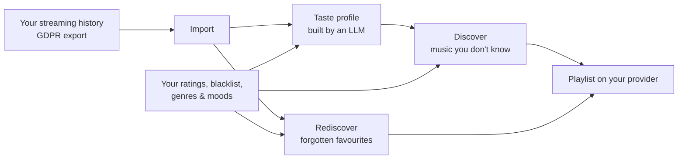

# Why MuseFlow

## A personal itch

I have been passionate about music for as long as I can remember, and I have been a heavy Spotify user for years.
What I enjoy most is not replaying what I already know: it is stumbling on a track I have never heard and that
instantly feels like *mine*.

Over time, that feeling became rarer. My recommendations kept circling around the same artists, the same hits,
the same "safe" picks. So I started asking a simple question: **who is the recommendation actually for?**

## The problem: recommendations are a business, not a service

A streaming platform does not only serve listeners. It also negotiates with labels, sells promotion, and has a
catalogue whose costs are not equal from one track to another. Its recommendations are shaped by those constraints —
Spotify's own *Discovery Mode*, for instance, lets artists and labels accept a lower royalty rate on selected tracks in
exchange for a boost in algorithmic recommendations.

Put bluntly, a large part of the recommendation engine behaves like a **B2B product** — tuned for the industry and
its revenue — wearing a **B2C interface**. That is a perfectly rational business choice. It is just not aligned with
what I want as a listener: *music I would love, that I don't know yet, for the mood I am in right now.*

MuseFlow takes the other side of that trade-off. It is built for **one stakeholder only: the listener**.

## What MuseFlow does

1. **Import** the streaming history your provider is legally required to give you.
2. **Profile** your taste with an LLM: eras, core identity, current vibe, what you dislike. You can keep several
   named profiles.
3. **Discover** new tracks from that profile — few, high-confidence picks rather than a long list of guesses.
4. **Rediscover** tracks you loved years ago and the algorithm stopped showing you.
5. **Rate** what you hear. You are the judge, not a model guessing from your skips.

## Why I built it: three reasons, honestly

**1. I wanted the tool.** I use it. My own listening history is the first dataset, and I am the first user.
Everything in the [insights page](insights.md) comes from dogfooding.

**2. A showcase that is real.** As a backend engineer, I wanted a project I can show that is not a to-do app:
real external APIs with rate limits and OAuth, real data volumes (hundreds of thousands of plays), LLMs in
production-like conditions, a strict architecture, and 100% branch coverage. And I wanted it to show *how I
reason about a product*, not only how I write code — hence this section.

**3. A sandbox to keep learning.** Both technically (async Python, hexagonal architecture, LLM integration,
AI-assisted development) and product-wise: what happens when your main dependency changes the rules? How do you
pivot without throwing everything away? The [V1 → V2 pivot](pivot.md) is the best answer I have to that.

## Who it is for

- **First, me.** It is a personal proof of concept. I would rather build something that truly works for one person
  than something vaguely useful for everyone.
- **Developers with the same itch.** If you love music, own a long listening history and are comfortable with a CLI,
  you can run it on your own machine.
- **Maybe, one day, more people.** The CLI exists so I could use the product without building a UI first. The API
  layer (FastAPI) is already there. A hosted version is *conceivable* — the [business model sketch](business-model.md)
  explores it — but it is not a plan, and I am not pretending otherwise.
