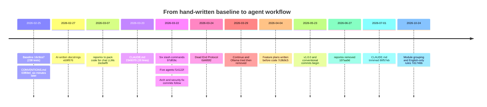
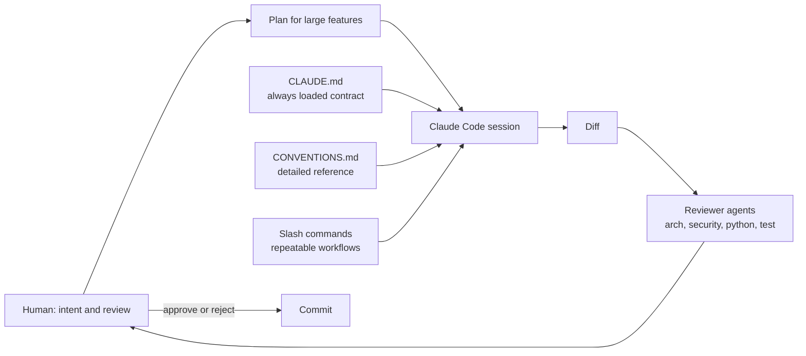

# AI-assisted development

This page documents how AI tooling was introduced into the project, in the order it happened, with commit hashes so each statement can be checked with `git show`. The short version: **the reference code and the written standards came first; the agent came second and was asked to follow them.** The human remains the decision-maker and reviews every diff.

## The premise

The proof-of-concept that preceded the repository was written by hand, with occasional help from a chat LLM. The first commit of this repository that matters is the baseline `16c9ce7` (2026-02-25). It already contained the full hexagonal layout (`domain`, `application`, `infrastructure`), a generic OAuth flow, a Spotify client, FastAPI and Typer entrypoints, 238 tests, and CI with Codecov.

Its `ROADMAP.txt` ended with an "AI agents" item (`git show 16c9ce7:ROADMAP.txt`):

> Once the project is stable, try to auto-generate the agents scripts

The order is the point. A coding agent is most useful, and least damaging, on a codebase where the architecture, naming and testing rules already exist and are demonstrated by working code. Writing that base by hand first meant the agent's job was to extend a solid pattern, not to invent one.

## Timeline

| Step | Commit | Date | What and why |
|---|---|---|---|
| Written conventions | `03f69ef` | 2026-02-25 | `CONVENTIONS.md` added six minutes after the baseline: layer rules, naming, logging, testing |
| AI-written docstrings | `eb9f876` | 2026-02-27 | Docstrings and convention updates generated with an LLM ("Up doc with AI") |
| repomix | `2ecbef9` | 2026-03-07 | Pack the whole repository into one file to paste into a chat LLM. Removed in `107aa9d` (2026-06-27) |
| `CLAUDE.md` | `2349370` | 2026-03-20 | First Claude Code session file: 26 lines |
| Slash commands | `97df08c` | 2026-03-22 | Six commands in `.claude/commands/` |
| Agents | `f14122f` | 2026-03-22 | Five agents in `.claude/agents/`. The same day: `c4c9495`, `44f281e`, `0944340` ("Fix arch review" and follow-ups); later `316a29a` ("Fix security issues") and `2b107f7` ("Arch review") |
| Dead End Protocol | `0d485f2` | 2026-03-24 | A 3-attempt cap on fixing a failing test, then stop and present options A / B / C instead of looping |
| Plans before code | `7c9b9c5`, `6d8c52a` | 2026-04-04, 2026-05-23 | Seven taste-profile plan files (~1,100 lines) and `plan_v2.md` were committed as working documents. The taste-profile plans were deleted in `c95d10b` (2026-04-06, "plan 6 - final with cli command") and `plan_v2.md` at the V2 cleanup (`af43b52`) |
| Instruction diet | `86f57eb` | 2026-07-01 | `CLAUDE.md` cut from 442 to 245 lines (+59 / -223 in the commit), because it is loaded into every session and costs tokens every time |
| Conventional commits and trailers | from `d80bc85` | 2026-05-23 | `feat:` / `fix:` / `chore:` prefixes from late May; `Co-Authored-By` trailers on 15 commits, 12 of them in October 2026 |

## Growth

Measured with `git ls-tree` / `git show` on each revision (Python lines under `museflow/`, `def test_` occurrences under `tests/`):

| Revision | Date | Source lines | Test functions |
|---|---|---|---|
| Baseline `16c9ce7` | 2026-02-25 | 3,430 | 238 |
| Claude Code start `2349370` | 2026-03-20 | 5,909 | 358 |
| `v1.0.0` (`9dcf396`) | 2026-05-23 | 9,063 | 587 |
| `HEAD` (`aebe41d`) | 2026-10-25 | 12,122 | 1,000 |

The project grew roughly 3.5 times in source and 4 times in tests after the agent was introduced, while the 100% branch gate stayed on. That is the claim the structure is designed to support; it is not evidence that the code is flawless.

## How it works day to day

- **`CLAUDE.md` is the always-loaded contract**: stack, architecture, naming, logging, error handling, testing rules and the Dead End Protocol. It is short on purpose (see the diet above).
- **[`CONVENTIONS.md`](https://github.com/ychab/museflow/blob/main/CONVENTIONS.md) is the detailed reference**, read when needed rather than on every session. `tests/CLAUDE.md` points the agent at the testing rules.
- **Commands encode repeatable workflows** so the same checklist is applied each time instead of being re-explained.
- **Agents are specialised reviewers**, "virtual teammates with roles" in the author's words, explicitly not people. Their narrow scope comes from their instructions; the agent definitions do not restrict tools in their frontmatter, so "read-only" for `engineer` is an instruction, not a sandbox.
- **The human decides and reviews every diff.** Nothing is merged on an agent's say-so, and the 100% branch gate, Ruff, mypy and deptry run regardless of who wrote the change.
- **Plan first for large features**, so the review happens on a short plan before it has to happen on a large diff.

### Rules added over time

`CLAUDE.md` is edited as patterns that keep coming back wrong are identified. Examples, found with `git log -S"<rule text>" -- CLAUDE.md`:

| Rule | Commit | Date |
|---|---|---|
| Never create `_make_*` test-data helpers; use factories | `892526e` (reworded in `a36adc3`, `55bbeb3`) | 2026-04-11 |
| Group function parameters by role; DI parameters contiguous | `f5f59d5` | 2026-05-29 |
| CLI output belongs in the callback, not in `*_logic` | `bebd543` | 2026-06-13 |
| No `assert` in production code | `78d874a` | 2026-06-27 |
| Group same-kind module members; everything written for the repo is English | `7d1746b` | 2026-10-24 |
| No duplicated inner functions (centralise as a decorator) | `a8ad2dc` | 2026-10-25 |

Most rules are advisory to the agent and enforced by review, not by tooling, so they can drift: the `assert` ban dates from June, yet two `assert` statements had crept into production modules. It is now enforced by Ruff (`S101`) and none remain. Moving a rule from prose into a lint rule is the more durable fix when one is available.

## Commands and agents

The project configures [Claude Code](https://claude.ai/claude-code) through `CLAUDE.md`, `CONVENTIONS.md`, `.claude/commands/` and `.claude/agents/`.

### Commands (skills)

Invoke in a Claude Code session with `/command-name [arguments]`.

| Command | Invocation | What it does |
|---|---|---|
| `/new-feature` | `/new-feature <name>` | Scaffolds a feature across all layers: entity, input schema, port, use case, SQLAlchemy model, repository, API endpoint, CLI command, unit and integration tests |
| `/new-migration` | `/new-migration <description>` | Guides an Alembic migration: generates the file, reviews nullable defaults and `downgrade()`, verifies it runs cleanly |
| `/add-tests` | `/add-tests <file_path>` | Analyses a source file and generates unit and integration tests targeting 100% branch coverage, reusing existing fixtures and factories |
| `/new-provider` | `/new-provider <name>` | Scaffolds a new music provider integration (client, session, library adapter, DTOs, mappers, schemas, types, exceptions, settings, WireMock stubs, tests) mirroring the Spotify pattern |
| `/arch-review` | `/arch-review [files]` | Reviews changed files for Clean Architecture violations (framework imports in domain, repositories instantiated in use cases, wrong `JSONB` / `ARRAY` dialect, missing `to_entity()`, logging secrets) |
| `/security-review` | `/security-review [files]` | Reviews changed files for security issues (hardcoded secrets, unprotected endpoints, unbounded `Retry-After` sleeps, raw SQL, missing input validation, path traversal) and runs `uv audit` for CVEs |

### Agents

Agents are subagents with their own instructions, routed to automatically or invoked explicitly.

| Agent | What it does |
|---|---|
| `python` | Fixes lint errors autonomously: runs `make lint`, fixes Ruff / mypy / deptry findings, iterates until clean |
| `test` | Fixes failing tests and fills coverage gaps: runs `make test`, traces failures, writes missing branches; applies the Dead End Protocol |
| `arch` | Architecture compliance review of changed files against the hexagonal rules |
| `security` | Security review of changed files; runs `uv audit` for CVEs |
| `engineer` | Explains the codebase (feature flows, where things live); read-only by instruction |

## Lessons

**What worked**

- **Conventions first.** Writing `CONVENTIONS.md` before any agent existed gave the agent something concrete to imitate and gave reviews something concrete to check against.
- **Reviewer agents on a separate pass.** `arch` and `security` drove fix commits within days of being introduced (listed above), because a reviewer with a narrow checklist catches what a generating session overlooks.
- **A cap on flailing.** The Dead End Protocol turns "the agent is stuck in a loop" into "the agent stops and offers three options", which keeps the human in the decision.
- **Plans before code**, for the features large enough to need one.
- **The 100% branch gate as a backstop.** It makes unreviewed shortcuts visible regardless of who wrote them.

**What did not**

- **Local-model tooling.** A Continue plugin with a local Ollama `qwen2.5-coder` model was added in `fca41e1` and removed 24 minutes later in `6057540` (2026-03-29); aider left only a `.gitignore` entry (`19682fe`). Neither fit the workflow.
- **repomix.** Useful while pasting code into a chat window, redundant once an agent could read the repository itself; removed in `107aa9d`, almost four months after it was added.
- **Oversized always-loaded instructions.** `CLAUDE.md` grew to 442 lines and was loaded into every session. Cutting it to 245 kept the rules that change behaviour and moved detail to `CONVENTIONS.md` and per-directory files.
- **Rules without enforcement.** Prose rules drift (see the `assert` example above, now enforced by Ruff `S101`).
