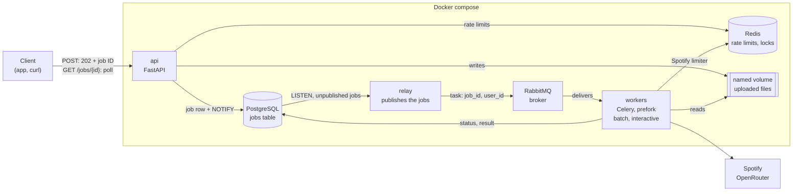
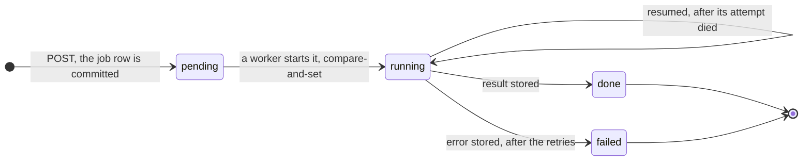
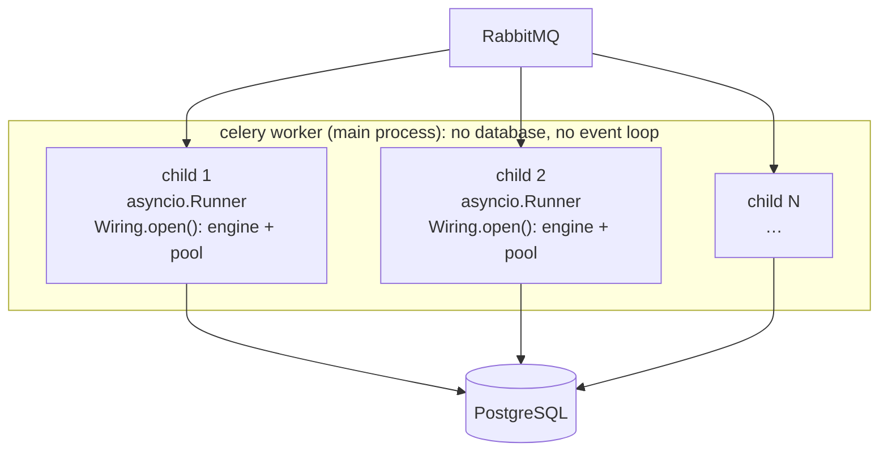

# API and workers

MuseFlow is a single-user CLI. Epic #271 opens it to a few users (Spotify's development mode caps the app at a
handful) through the API, with the long flows (enrichment, taste profile build, playlist creation, history import)
running as background jobs on Celery workers. It is a learning showcase: a production-like stack (FastAPI, Celery,
RabbitMQ, Redis) rather than the leanest one.

This page holds the decisions every sub-issue of the epic relies on, so that each one works from the same choices
instead of the issue threads. The epic is built on the `feat/api-workers` branch; each section names the sub-issue
that builds its part.

<div class="seq-legend">
  <span><i></i>Call between programs</span>
  <span><i class="fail"></i>Fails, or is refused</span>
</div>

## At a glance



| Concern | Choice | Rejected, and why |
|---|---|---|
| Task queue | Celery 5.7 (supports Python 3.14) | A custom queue: retries, acknowledgements and dead letters to rewrite. Lighter queues (arq, Dramatiq, Taskiq): Celery is what most job offers and codebases name |
| Broker | RabbitMQ | Redis as a broker: a task survives a dead worker only through a visibility timeout to tune against the longest task, where RabbitMQ redelivers an unacknowledged message as soon as the connection drops |
| Shared state between processes | Redis: rate limits (#264), the Spotify limiter (#268), locks | PostgreSQL: possible, but a counter written on every request belongs in memory with a TTL |
| Job state | A `jobs` table in PostgreSQL (#261) | A Celery result backend: see [below](#the-jobs-table-is-the-source-of-truth) |
| Publishing a job | The `jobs` table is the outbox, a relay publishes its message (#261) | The API publishing after its commit: a crash in between loses the message. See [below](#the-relay-the-jobs-table-is-the-outbox) |
| Files | `FileStoragePort` on a named volume (#249, #260) | A cloud bucket now: a cost for a few users; it is one more adapter later |
| Task queues | Two, by who waits: `museflow.batch` and `museflow.interactive`, each with workers of its own | One queue: a playlist waits behind a first enrichment. RabbitMQ priorities: they reorder the waiting messages, never a running task. A queue per use case: as many worker pools for no gain. See [below](#two-queues-by-who-waits) |
| Services | One application, three entrypoints | Microservices: out of scope, see [lessons learned](../product/lessons-learned.md#if-it-grew-services-not-one-app) |

## The jobs table is the source of truth

A long flow can't run inside an HTTP request: it takes minutes, the client may leave, and a redeployment would cut it.
The API records the job, queues a task and answers at once; the client then polls the job.

- **`POST` answers `202 Accepted`** with the job ID (and a `Location: /api/v1/jobs/{id}` header). The client polls
  `GET /jobs/{id}` until the job is `done` or `failed`; `GET /jobs` lists the user's jobs, paged.
- **No Celery result backend.** Celery's results are keyed by task ID, expire, and know nothing of users. The `jobs`
  table holds what the client asks for: the user, the kind, the status, the input, the result (the use case's report)
  or the error, and the timestamps. It is queried like any other table and scoped to the current user. Tasks run
  with `ignore_result=True`.
- **No SSE nor progress percentage.** A job is short enough to poll every few seconds, and a percentage needs a
  total known in advance, which most flows (discovery rounds, LLM batches) don't have. Progress goes to the logs
  ([below](#progress-goes-to-the-logs)).
- **One job of a kind at a time per user.** A partial unique index on `(user_id, kind)`, restricted to the `pending`
  and `running` statuses, refuses a second one: a domain error, `409 Conflict`. Two enrichments of the same tracks
  would pay the LLM twice.
- **The API never publishes.** It commits the job, and a relay publishes its task message
  ([below](#the-relay-the-jobs-table-is-the-outbox)): the API accepts jobs even while RabbitMQ is down.
- **A task message carries IDs only** (`job_id`, `user_id`), never a serialised entity. The task reloads what it
  needs, so a redelivered message never runs on stale data, and the message never holds a token or a profile.



### One job, end to end

The first job, enrichment (#262), sets the pattern every other job copies.

<div class="seq">
<script type="application/json">
{
  "lanes": [
    {"id": "client", "name": "Client", "sub": "app, curl", "color": "grey"},
    {"id": "api", "name": "API", "sub": "FastAPI", "color": "teal"},
    {"id": "db", "name": "PostgreSQL", "sub": "museflow_job", "color": "indigo"},
    {"id": "relay", "name": "Relay", "sub": "publishes", "color": "green"},
    {"id": "mq", "name": "RabbitMQ", "sub": "task queue", "color": "amber"},
    {"id": "worker", "name": "Worker", "sub": "Celery task", "color": "teal"},
    {"id": "llm", "name": "OpenRouter", "sub": "paid LLM calls", "color": "grey"}
  ],
  "steps": [
    {"phase": "Queue, inside the request: one transaction"},
    {"from": "client", "to": "api", "text": "<code>POST /api/v1/tracks/enrichment</code> (config)", "detail": "Bearer access token"},
    {"note": "api", "style": "check", "text": "A paid job: within the user's LLM budget? (#263)"},
    {"from": "api", "to": "db", "text": "<code>INSERT</code> the job, <code>pending</code>, <code>published_at</code> empty; <code>pg_notify</code>; commit", "detail": "The notification leaves on commit only: a rollback sends none"},
    {"from": "db", "to": "api", "text": "A job of this kind is already pending or running", "style": "fail", "detail": "The partial unique index refuses it: <code>409 Conflict</code>"},
    {"from": "api", "to": "client", "text": "<code>202 Accepted</code>, the job ID", "detail": "<code>Location: /api/v1/jobs/{id}</code>; no call to RabbitMQ"},
    {"phase": "Publish, in the relay"},
    {"from": "db", "to": "relay", "text": "<code>NOTIFY</code> wakes the relay, which listens (<code>LISTEN</code>)", "detail": "Otherwise it wakes up every 5 seconds: a notification missed while it restarted is caught up"},
    {"from": "relay", "to": "db", "text": "Block 1: reads the jobs whose <code>published_at</code> is empty, the oldest first"},
    {"from": "relay", "to": "mq", "text": "Publishes each task <code>(job_id, user_id)</code>, confirmed by the broker", "detail": "Publisher confirms, out of any transaction. IDs only, never an entity nor a token"},
    {"from": "relay", "to": "db", "text": "Block 2: <code>published_at = now()</code> for those confirmed"},
    {"phase": "Run, in a worker"},
    {"from": "mq", "to": "worker", "text": "Delivers the message", "detail": "One at a time per process (prefetch 1), acknowledged at the end (acks late)"},
    {"from": "worker", "to": "db", "text": "Block: starts the job, <code>pending → running</code>, by a compare-and-set", "detail": "A message for a job already running is a duplicate, dropped, unless its attempt died: <a href=\"#a-message-for-a-job-already-running\">below</a>"},
    {"from": "worker", "to": "llm", "text": "The use case runs: LLM batches outside any transaction", "detail": "Each batch committed in its own block, as on the CLI"},
    {"note": "worker", "style": "check", "text": "Killed mid-run: the message was never acknowledged", "detail": "RabbitMQ redelivers it; the job resumes from its committed checkpoints"},
    {"from": "worker", "to": "db", "text": "Block: <code>done</code>, the report as the result"},
    {"from": "worker", "to": "db", "text": "Or, after the retries: <code>failed</code>, with the name of the error", "style": "fail", "detail": "Transient errors only are retried, with backoff; then the dead-letter queue"},
    {"from": "worker", "to": "mq", "text": "Acknowledges the message"},
    {"phase": "Poll"},
    {"from": "client", "to": "api", "text": "<code>GET /api/v1/jobs/{id}</code>, every few seconds"},
    {"from": "api", "to": "db", "text": "<code>SELECT … WHERE id = … AND user_id = …</code>", "detail": "Another user's job is a 404, as an unknown one"},
    {"from": "api", "to": "client", "text": "The status, then the result or the error"}
  ]
}
</script>
</div>

### Delivery and retries

- **At least once.** `acks_late` acknowledges a message once the task is over, not when it is received: a worker that
  dies mid-task leaves its message to another worker. The price is that a task may run twice, so **every task is
  idempotent**: it starts its job by a compare-and-set first
  ([below](#a-message-for-a-job-already-running)), and the use cases already resume from their checkpoints (enrichment,
  profile build, history import chunks).
- **Retries for transient errors only**, with an exponential backoff and jitter: the database or the network
  unreachable (`TRANSIENT_ERRORS` in `entrypoints/worker/const.py`), `MUSEFLOW_WORKER_TASK_MAX_RETRIES` times (5),
  each wait capped at `MUSEFLOW_WORKER_TASK_RETRY_BACKOFF_MAX_SECONDS` (600). The adapters already retry their own
  HTTP calls (tenacity); a task does not retry a domain error, which would fail the same way.
- **Two ways to lose a worker.** The whole worker dies (a crash, a redeploy killing the container): its connection
  drops and RabbitMQ redelivers the message, flagged `redelivered`. Only the process running the task dies (the
  out-of-memory killer): the worker stays up, sees the process lost and retries the task like a transient error
  (`task_retry_on_worker_lost`), up to the same limit. A plain requeue would loop forever on a task that kills its
  process every time.
- **A dead-letter queue**, `museflow.dead_letter`, keeps the messages of the failed tasks: after their retries, or at
  once for an error not worth one (`task_acks_on_failure=False` rejects them, and RabbitMQ moves them there). They are
  inspected in the RabbitMQ UI (`http://localhost:15672`) or with `make broker-dead-letters` instead of being lost. The worker declares it when it
  starts, as no worker consumes it.
- **RabbitMQ's consumer timeout** (30 minutes by default) closes the channel of a message left unacknowledged longer
  than that, which `acks_late` does for a long task. Each queue sets its own (`x-consumer-timeout`): the shorter it
  is, the sooner a consumer that hangs for good is caught. The longest job, a first enrichment, took 8 minutes for
  10,000 tracks (51 LLM batches of 200): `museflow.batch` raises it to 2 hours, room for a library several times
  larger and for slow LLM retries. `museflow.interactive` lowers it to 15 minutes, several times a playlist (a
  minute or two, estimated until #267 measures it).

### Two queues, by who waits

The jobs are not split by length (nearly all of them are long) but by who waits for them:

| Queue | Tasks | Length | Who waits |
|---|---|---|---|
| `museflow.batch` | History import (#265), enrichment (#262), taste profile build (#266) | Seconds for an import (no remote call), 8 minutes for a first enrichment (measured), minutes for a profile build | No one: background work, long and paid |
| `museflow.interactive` | Playlist creation (#267): discover, explore, history | Seconds to a minute or two (estimated) | The user, in front of the screen |

The rest stays synchronous in the API: short reads and writes (ratings, blacklist, playlist delete, YAML imports and
exports).

- **Workers apart, not priorities.** With 2 processes, one user signing up (import, then enrichment, then profile
  build) holds both for about 15 minutes. A worker's processes are shared by all the queues it consumes, and a
  RabbitMQ priority only reorders the waiting messages, never a running task: only a worker per queue keeps a
  playlist from waiting. Docker Compose runs `worker-batch` (`--queues museflow.batch`) and `worker-interactive`
  (`--queues museflow.interactive`, `MUSEFLOW_WORKER_INTERACTIVE_CONCURRENCY`); `make run-worker` consumes both.
- **Routed by name.** A task goes to the batch queue unless its name routes it elsewhere: `task_routes` sends
  `playlist.*` to the interactive one. A task is named `<theme>.<object>_<verb>` (`track.history_import`).
- **Named for good.** RabbitMQ never renames a queue nor changes its arguments (dead letter, consumer timeout): a
  declaration with other ones is refused (`PRECONDITION_FAILED`). A change takes a new queue, the old one drained,
  then deleted; hence the two queues set before the first deployment, with their timeouts.
- **One dead-letter queue for both.** A dead-lettered message keeps its task in the `task` header and its queue in
  `x-first-death-queue`.

### The relay: the jobs table is the outbox

Committing the job row and publishing its message are two writes to two systems, with no transaction across them
(the *dual write* problem). Publishing from the API after its commit, a publish that fails or an API dying in between
would leave the job `pending` with no message, and the unique index would refuse every new job of its kind; publishing
before the commit, a worker could get a job not committed yet, or rolled back.

The answer is a **transactional outbox**, where the `jobs` table is the outbox: no table of its own. The API only
commits the job, with an empty `published_at` and a `pg_notify` in the same transaction. A **relay**, a process of its
own, publishes the message of every job whose `published_at` is empty, then sets it:

- **Woken by `LISTEN/NOTIFY`**, PostgreSQL's own messaging: a notification reaches the listeners when its transaction
  commits, never if it rolls back. It is lost while no one listens, so the relay also polls every 5 seconds; the table
  stays the truth, the notification only wakes the relay sooner.
- **Out of any transaction while it publishes**: block 1 reads the unpublished jobs, the messages go out with
  publisher confirms (RabbitMQ answers once it stored each one), block 2 marks them published. A publish the broker
  refuses stops the round; the job waits for the next one.
- **At least once.** A relay dying between the publish and block 2 publishes the job again when it restarts; the
  worker drops the duplicate ([below](#a-message-for-a-job-already-running)).
- **A single relay**, run from the worker's package (`python -m museflow.infrastructure.entrypoints.worker.relay`, the
  `relay` service of Docker Compose, `make run-relay` on the host): it publishes through the workers' Celery app, so
  their routes and queues.

<div class="seq">
<script type="application/json">
{
  "lanes": [
    {"id": "api", "name": "API", "sub": "FastAPI", "color": "teal"},
    {"id": "db", "name": "PostgreSQL", "sub": "museflow_job", "color": "indigo"},
    {"id": "relay", "name": "Relay", "sub": "publishes", "color": "green"},
    {"id": "mq", "name": "RabbitMQ", "sub": "broker", "color": "amber"},
    {"id": "worker", "name": "Worker", "sub": "Celery task", "color": "teal"}
  ],
  "steps": [
    {"phase": "1. The API dies right after its commit"},
    {"from": "api", "to": "db", "text": "Commits the job"},
    {"note": "api", "text": "Crashes", "style": "refused", "detail": "Publishing from the API, the message would never leave: the job pending for good, its kind blocked"},
    {"from": "relay", "to": "mq", "text": "The job is in the table: the relay publishes it all the same"},
    {"note": "worker", "text": "The job runs", "style": "done"},
    {"phase": "2. RabbitMQ is down"},
    {"from": "relay", "to": "mq", "text": "The publish fails", "style": "fail"},
    {"note": "relay", "text": "<code>published_at</code> stays empty: tried again on the next round, until the broker is back", "detail": "The API still accepts jobs: they wait, <code>pending</code>"},
    {"phase": "3. The relay dies between the publish and block 2"},
    {"from": "relay", "to": "mq", "text": "Message published and confirmed"},
    {"note": "relay", "text": "Crashes before <code>published_at</code>", "style": "refused"},
    {"from": "relay", "to": "mq", "text": "Restarted, it publishes again: the job has two messages", "detail": "At least once"},
    {"from": "worker", "to": "db", "text": "Message 1 starts the job; message 2 finds it running, and is dropped", "detail": "Next section"}
  ]
}
</script>
</div>

**With several relays** (high availability), two of them would read the same jobs. The usual answer,
`SELECT … FOR UPDATE SKIP LOCKED`, holds a transaction open over the publish, the remote call the unit of work rules
keep out of a block; a short lease instead (the pattern of the taste profile build, #246) claims a batch in one short
transaction, publishes out of it, and lets another relay take the batch over once the lease expires. Nothing of it is
built: one relay publishes thousands of messages a second, and a few users start a few jobs a day. At a much larger
scale, the relay would read PostgreSQL's log instead (change data capture, Debezium).

### A message for a job already running

The task starts its job by a compare-and-set, `UPDATE … SET status = 'running' WHERE id = … AND status = 'pending'`:
two workers starting it at once queue on the row lock, and the second one, checking the status again on the row the
first committed, updates nothing. But a job left `running` does not say whether someone still works on it: a worker
killed mid-task never sets it back. The message tells:

| Job | Message | The worker |
|---|---|---|
| `pending` | any | starts it |
| `running` | fresh | drops it: a duplicate of the relay's (case a) |
| `running` | redelivered, or a retry (`retries > 0`) | resumes it: its attempt died (cases b, c) |
| `done`, `failed` | any | drops it: over |

**Case a: a duplicate of the relay.**

<div class="seq">
<script type="application/json">
{
  "lanes": [
    {"id": "relay", "name": "Relay", "sub": "publishes", "color": "green"},
    {"id": "mq", "name": "RabbitMQ", "sub": "broker", "color": "amber"},
    {"id": "a", "name": "Worker A", "sub": "container 1", "color": "teal"},
    {"id": "b", "name": "Worker B", "sub": "container 2", "color": "indigo"},
    {"id": "db", "name": "PostgreSQL", "sub": "museflow_job", "color": "grey"}
  ],
  "steps": [
    {"phase": "The relay publishes twice (case 3 above)"},
    {"from": "relay", "to": "mq", "text": "Message 1, then message 2 after its restart"},
    {"phase": "Message 1 starts the job"},
    {"from": "mq", "to": "a", "text": "Delivers message 1"},
    {"from": "a", "to": "db", "text": "Starts the job: <code>pending → running</code>, one row updated", "detail": "Two workers starting it at once queue on the row lock; the second one checks the status again on the committed row"},
    {"phase": "Message 2 comes meanwhile"},
    {"from": "mq", "to": "b", "text": "Delivers message 2", "detail": "A fresh message: <code>redelivered = false</code>, <code>retries = 0</code>"},
    {"from": "b", "to": "db", "text": "Starts the job: no row updated, the job is running", "style": "fail"},
    {"note": "b", "text": "Running + a fresh message: a duplicate, someone works on it. Acknowledged and dropped", "style": "refused"},
    {"from": "a", "to": "db", "text": "<code>done</code>, with the result"},
    {"note": "db", "text": "The job ran once, the LLM was paid once", "style": "done"}
  ]
}
</script>
</div>

**Case b: the whole worker dies.**

<div class="seq">
<script type="application/json">
{
  "lanes": [
    {"id": "mq", "name": "RabbitMQ", "sub": "broker", "color": "amber"},
    {"id": "a", "name": "Worker A", "sub": "container 1", "color": "teal"},
    {"id": "b", "name": "Worker B", "sub": "container 2", "color": "indigo"},
    {"id": "db", "name": "PostgreSQL", "sub": "museflow_job", "color": "grey"}
  ],
  "steps": [
    {"from": "mq", "to": "a", "text": "Delivers the message"},
    {"from": "a", "to": "db", "text": "Starts the job, then commits batches 1 to 3, each in its own block"},
    {"note": "a", "text": "Container killed mid-batch 4 (a redeploy): nothing acknowledged", "style": "refused"},
    {"note": "mq", "text": "The connection of A drops: the unacknowledged message goes back to the queue"},
    {"from": "mq", "to": "b", "text": "Delivers the same message again", "detail": "<code>redelivered = true</code>"},
    {"from": "b", "to": "db", "text": "Starts the job again: running + redelivered, its worker died", "style": "", "detail": "No one works on it any more"},
    {"from": "b", "to": "db", "text": "Skips batches 1 to 3, already committed, runs the rest, then <code>done</code>"},
    {"note": "db", "text": "Dropping the message instead would leave the job running for good, its kind blocked by the unique index", "style": "done"}
  ]
}
</script>
</div>

**Case c: only the child process dies.**

<div class="seq">
<script type="application/json">
{
  "lanes": [
    {"id": "mq", "name": "RabbitMQ", "sub": "broker", "color": "amber"},
    {"id": "main", "name": "Worker A", "sub": "main process", "color": "teal"},
    {"id": "c1", "name": "Child 1", "sub": "runs the task", "color": "indigo"},
    {"id": "c2", "name": "Child 2", "sub": "forked instead", "color": "green"},
    {"id": "db", "name": "PostgreSQL", "sub": "museflow_job", "color": "grey"}
  ],
  "steps": [
    {"from": "mq", "to": "main", "text": "Delivers the message"},
    {"from": "main", "to": "c1", "text": "Hands the task to child 1"},
    {"from": "c1", "to": "db", "text": "Starts the job, commits batches 1 and 2"},
    {"note": "c1", "text": "Killed by the kernel, out of memory: the main process survives", "style": "refused"},
    {"note": "main", "text": "Sees the child lost (<code>WorkerLostError</code>), forks child 2"},
    {"from": "main", "to": "mq", "text": "Publishes a retry of the task, acknowledges the original", "detail": "<code>task_retry_on_worker_lost</code>: a new message, <code>retries = 1</code>"},
    {"from": "mq", "to": "main", "text": "Delivers the retry, to child 2"},
    {"from": "c2", "to": "db", "text": "Starts the job again: running + a retry, its attempt died; resumes at batch 3"},
    {"note": "db", "text": "Not redelivered (a new message), but <code>retries</code> tells", "style": "done"}
  ]
}
</script>
</div>

**Accepted risk: a job left running.** Two failures still leave a job `running` for good, its kind blocked: a process
lost on every try, dead-lettered after its retries with no code left to fail the job, and the database unreachable
when the last try fails it. Both need the job state written by someone other than the dying attempt: a sweeper that
fails the jobs running for too long without a heartbeat (#299). Until then, the operator fails such a job by hand.

**Retention.** Nothing removes the ended jobs yet: the table grows by a few rows per user and per day, which the
indexes on the user and on the active jobs absorb. The sweeper of #299 will purge those past a retention period.

## The worker is a third entrypoint

The worker sits next to the CLI and the API under `infrastructure/entrypoints/` (#260): like them, it parses its
input (the task message), builds its adapters from the shared `Wiring`, and calls a use case. A task holds no logic.



- **Prefork pool, sync tasks.** Celery runs a task as a plain function. Each child process opens one
  `asyncio.Runner` in `worker_process_init` and keeps it for its life; a task runs its coroutine on it
  (`runner.run(...)`). `worker_process_shutdown` closes it.
- **The engine is created in the child, not at import (#247).** A pool of connections is bound to the event loop that
  opened it, and a socket must not cross a `fork`. `Wiring.open()` is entered in the child's runner, so each child
  holds its own engine; the same process resource feeds every task of that child, as the CLI's does for one command.
  `asyncio.run()` per task would rebuild the pool every time.
- **The connection budget.** Every child holds a pool: the database sees up to
  *children × (`DATABASE_POOL_SIZE` + `DATABASE_MAX_OVERFLOW`)* connections from the workers, plus the API's. A
  child runs one task at a time, which needs one connection for the use case and one for a provider token refresh:
  the worker services of Docker Compose set a pool of 2 plus 1 overflow, and 2 children each
  (`MUSEFLOW_WORKER_CONCURRENCY`, `MUSEFLOW_WORKER_INTERACTIVE_CONCURRENCY`), so 12 connections, next to the API's
  15 and the relay's 2 (one pooled, one listening), well within PostgreSQL's 100. Another worker, or more children,
  adds 3 connections each.
- **One user's flow, the same use case.** A task calls the use case the CLI calls, with the same unit of work rules
  ([Unit of work](unit-of-work.md)): no transaction open during an LLM or Spotify call. The task is a thin sync
  function that runs a coroutine on the process's loop, as a CLI command runs its logic:

```python
@celery_app.task(name="track.history_import")
def import_history_task(job_id: str, user_id: str) -> None:
    run_task(_import_history(uuid.UUID(job_id), uuid.UUID(user_id)))


async def _import_history(job_id: uuid.UUID, user_id: uuid.UUID) -> None:
    wiring = get_wiring()  # the wiring of the process, opened in worker_process_init
    ...
```

## Progress goes to the logs

The use cases publish progress events through `ProgressPort` (the CLI renders them with Rich). The worker passes
`LogProgressAdapter`, which writes each event to the logs at `INFO` (`MUSEFLOW_LOG_LEVEL_WORKER`, `INFO` by
default): an operator follows a job with `docker compose logs worker`, or in the JSON log handler's output with the
data in `extra` ([Logging & output](logging.md)). A step that advances chunk by chunk logs at `DEBUG`, with an
`INFO` line every 30 seconds at most; counts only, never the user's tracks or artists. Not a no-op: a job that
runs for minutes without a trace can't be told from a stuck one. The client sees the status only; the trace of a
request across the API, the broker and the worker comes with OpenTelemetry (#269).

## Files go through the storage port

An upload (the streaming history export, #265) can't travel in a task message: a message stays small. The API
writes the files through `FileStoragePort` (#249), keyed per user (`history/<batch>/file.json`), and the message
carries the key. `LocalFileStorage` keeps a directory per user under `MUSEFLOW_FILE_STORAGE_DIR`, on a named Docker
volume mounted by `app` and both workers. A cloud bucket is one more adapter of the same port when the app is hosted
somewhere without a shared disk. The task deletes the files once the import is committed.

## API conventions

Set by #252 before the routes of every theme, so that they all answer the same way.

### Errors: problem details (RFC 9457)

Exception handlers registered on the app map each domain exception to a status code; the routes drop their own
`try/except`. The body is a *problem details* object, `Content-Type: application/problem+json`:

```json
{
  "type": "about:blank",
  "title": "Conflict",
  "status": 409,
  "detail": "A track enrichment is already running.",
  "instance": "/api/v1/tracks/enrichment"
}
```

| Status | When |
|---|---|
| `400` / `422` | A malformed request (FastAPI's validation keeps `422`) |
| `401` | No valid access token |
| `404` | Not found, **or another user's**: a client never learns that an ID exists |
| `409` | A conflict with the current state: a job of this kind already running, a duplicate name |
| `429` | A rate limit (#264), with `Retry-After` |
| `500` | Anything unmapped: a generic body, the traceback in the logs only |

The status of the LLM budget refusal (`429` or `402`) is decided in #263; whichever it is, the body never states an
amount.

### Pagination: offset, then cursor where a collection grows

- **Offset by default.** `limit` and `offset` query parameters, bounded, shared by the routes; a generic `Page[T]`
  response schema: `items`, `total`, `limit`, `offset`. The repository takes `limit` / `offset` in `get_list` and
  counts the total: no `fastapi-pagination`, the query stays in the repository.
- **Cursor (keyset) for the tracks (#259).** A user's tracks reach thousands of rows. An offset re-reads every skipped
  row and shifts when rows are inserted between two pages; a cursor resumes after the last row read:
  `WHERE (sort_key, id) > (:key, :id) ORDER BY sort_key, id LIMIT :n`, backed by a matching index. The cursor is
  opaque to the client, and the response has a `next_cursor` instead of a `total`.

```json
{"items": [], "total": 134, "limit": 20, "offset": 40}
{"items": [], "next_cursor": "eyJrIjoi4oCmIiwiaWQiOiLigKYifQ"}
```

## What stays out

- **Microservices**: one application, three entrypoints. The ports are where it would split.
- **A Celery result backend, SSE, progress percentages**: the jobs table and polling cover the need.
- **Migrations in production**: the single `initial` migration is still regenerated during development
  ([Data model](data-model.md)); a handful of family users can re-import.
