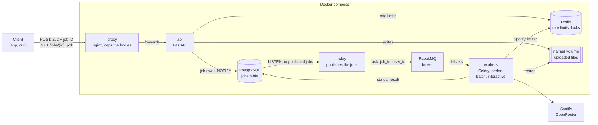
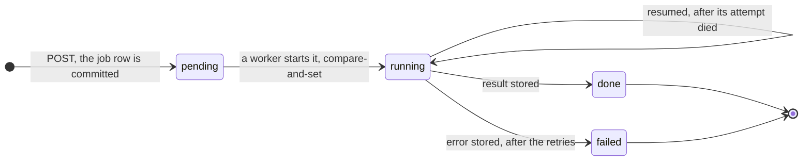
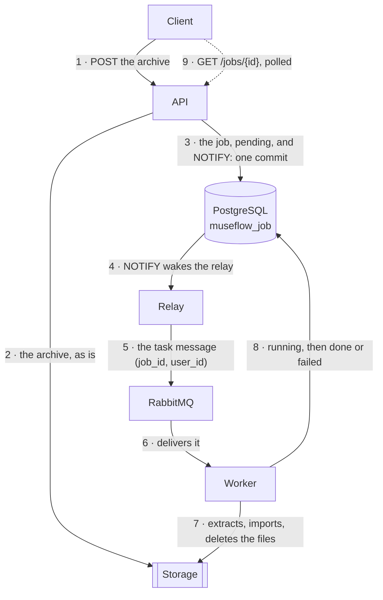
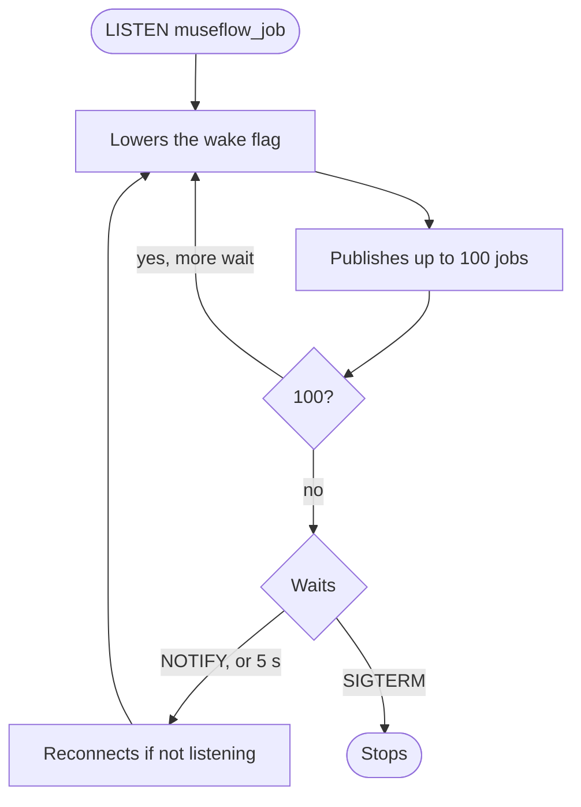
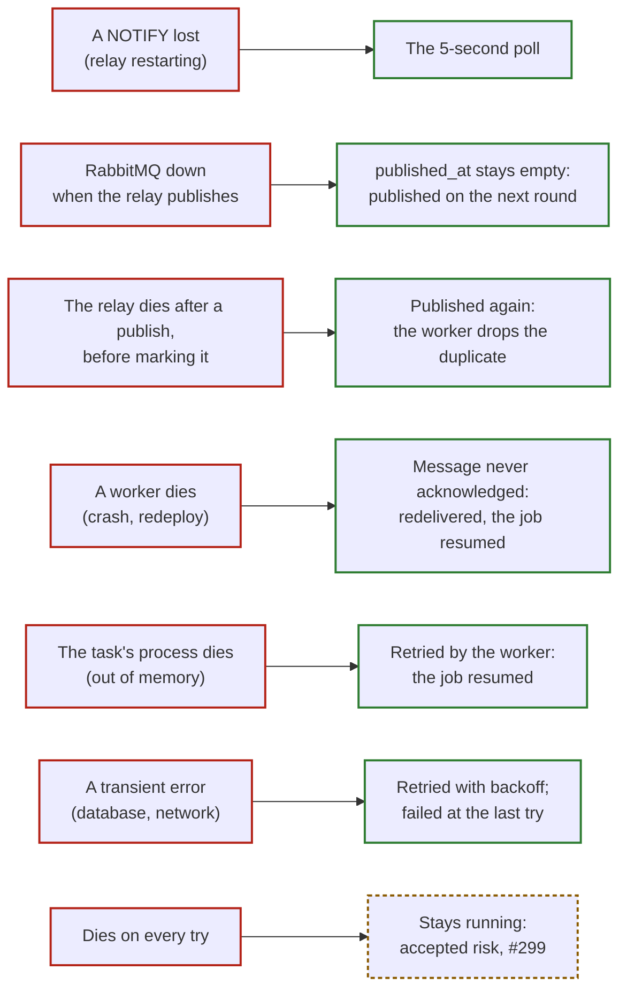
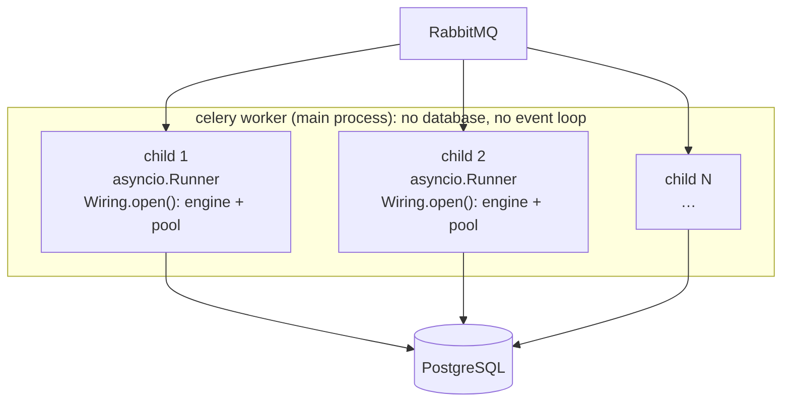
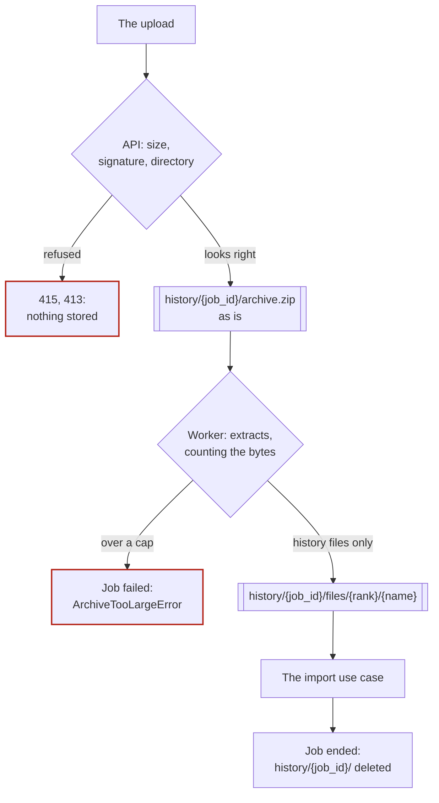
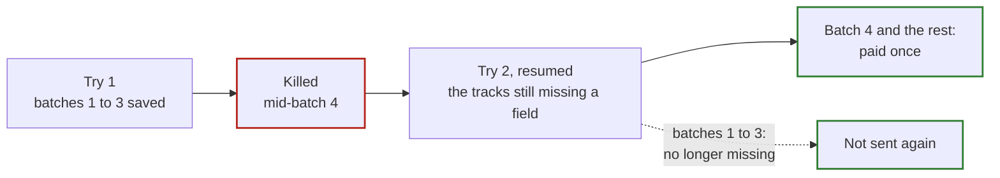

# API and workers

Epic #271 opens MuseFlow, a single-user CLI, to a few users through an API. The long flows (enrichment, taste profile
build, playlist creation, history import) run as background jobs on Celery workers. It is a learning showcase: a
production-like stack rather than the leanest one.

This page holds the decisions every sub-issue relies on; each section names the issue that builds it.

<div class="seq-legend">
  <span><i></i>Call between programs</span>
  <span><i class="fail"></i>Fails, or is refused</span>
</div>

## At a glance



| Concern | Choice | Rejected, and why |
|---|---|---|
| Task queue | Celery | A custom queue: retries, acknowledgements and dead letters to rewrite. Lighter ones (arq, Dramatiq): Celery is the one most codebases use |
| Broker | RabbitMQ | Redis: a dead worker's task comes back only after a visibility timeout, where RabbitMQ redelivers it at once |
| Shared state | Redis: rate limits (#264), the Spotify limiter (#268) | PostgreSQL: a counter written on every request belongs in memory |
| Job state | A `jobs` table (#261) | A Celery result backend: keyed by task, expiring, unaware of users |
| Publishing a job | A relay reads the `jobs` table (#261) | The API publishing after its commit: a crash in between loses the message |
| Files | A storage port on a named volume (#249) | A cloud bucket: a cost for now, one more adapter later |
| Task queues | Two, by who waits: batch and interactive | One queue: a playlist would wait behind an enrichment |
| In front of the API | An nginx reverse proxy (#304): the only service a client reaches, capping the request bodies | Uvicorn facing the clients: it receives a body whole before any check |
| Services | One application, three entrypoints | Microservices: out of scope, see [lessons learned](../product/lessons-learned.md#if-it-grew-services-not-one-app) |

## The jobs table is the source of truth

A long flow can't run inside an HTTP request: the API records the job, answers at once, and the client polls it.

- **`POST` answers `202 Accepted`** with the job ID. The client polls `GET /jobs/{id}` until the job is `done` or
  `failed`; `GET /jobs` lists the user's jobs.
- **One job of a kind at a time per user**: a partial unique index refuses a second one (`409 Conflict`). Two
  enrichments at once would pay the LLM twice.
- **A task message carries IDs only** (`job_id`, `user_id`): the task reloads what it needs, never stale data nor a
  token.
- **No result backend, no SSE, no percentage**: the table holds the status and the result or the error, and a job is
  short enough to poll.
- **Typed per kind**: `GET /jobs/{id}` documents the input and the result of each kind of job, the error as the name
  of its exception (#265).



### One job, end to end

The first job, the history import (#265), sets the pattern every other one copies:



??? example "Step by step, lane by lane (a history import)"

    <div class="seq">
    <script type="application/json">
    {
      "lanes": [
        {"id": "client", "name": "Client", "sub": "app, curl", "color": "grey"},
        {"id": "api", "name": "API", "sub": "FastAPI", "color": "teal"},
        {"id": "fs", "name": "Storage", "sub": "shared volume", "color": "amber"},
        {"id": "db", "name": "PostgreSQL", "sub": "museflow_job", "color": "indigo"},
        {"id": "relay", "name": "Relay", "sub": "publishes", "color": "green"},
        {"id": "mq", "name": "RabbitMQ", "sub": "task queue", "color": "amber"},
        {"id": "worker", "name": "Worker", "sub": "Celery task", "color": "teal"}
      ],
      "steps": [
        {"phase": "Queue, inside the request"},
        {"from": "client", "to": "api", "text": "<code>POST /api/v1/tracks/streaming-history</code>, the zip archive and the options", "detail": "Multipart, so Swagger can send it; Bearer access token"},
        {"note": "api", "style": "check", "text": "Checks without extracting: size, signature, central directory", "detail": "<a href=\"#files-go-through-the-storage-port\">Below</a>"},
        {"from": "api", "to": "fs", "text": "Stores the archive as is, under <code>history/{job_id}/</code>", "detail": "First: a job never points to a file not there yet"},
        {"from": "api", "to": "db", "text": "<code>INSERT</code> the job, <code>pending</code>, <code>published_at</code> empty; <code>pg_notify</code>; commit", "detail": "The notification leaves on commit only: a rollback sends none"},
        {"from": "db", "to": "api", "text": "A job of this kind is already pending or running", "style": "fail", "detail": "The partial unique index refuses it: the archive deleted, <code>409 Conflict</code>"},
        {"from": "api", "to": "client", "text": "<code>202 Accepted</code>, the job", "detail": "<code>Location: /api/v1/jobs/{id}</code>; no call to RabbitMQ"},
        {"phase": "Publish, in the relay"},
        {"from": "db", "to": "relay", "text": "<code>NOTIFY</code> wakes the relay, which listens (<code>LISTEN</code>)", "detail": "Otherwise it wakes up every 5 seconds: a notification missed while it restarted is caught up"},
        {"from": "relay", "to": "db", "text": "Block 1: reads the jobs whose <code>published_at</code> is empty, the oldest first"},
        {"from": "relay", "to": "mq", "text": "Publishes each task <code>(job_id, user_id)</code>, confirmed by the broker", "detail": "Publisher confirms, out of any transaction. IDs only, never the archive nor a token"},
        {"from": "relay", "to": "db", "text": "Block 2: <code>published_at = now()</code> for those confirmed"},
        {"phase": "Run, in a worker"},
        {"from": "mq", "to": "worker", "text": "Delivers the message", "detail": "One at a time per process (prefetch 1), acknowledged at the end (acks late)"},
        {"from": "worker", "to": "db", "text": "Block: starts the job, <code>pending → running</code>, by a compare-and-set", "detail": "A message for a job already running is a duplicate, dropped, unless its attempt died: <a href=\"#a-message-for-a-job-already-running\">below</a>"},
        {"from": "worker", "to": "fs", "text": "Reads the archive, extracts the history files one at a time, stores each"},
        {"note": "worker", "text": "The import use case, on the files extracted, as on the CLI", "detail": "A block per chunk of tracks; a play already saved is skipped, so a second run creates none"},
        {"from": "worker", "to": "db", "text": "Block: <code>done</code>, the report as the result"},
        {"from": "worker", "to": "db", "text": "Or, after the retries: <code>failed</code>, with the name of the error", "style": "fail", "detail": "Transient errors only are retried, with backoff; then the dead-letter queue"},
        {"from": "worker", "to": "fs", "text": "Deletes the archive and the files extracted", "detail": "Kept after a transient error, for the next try"},
        {"from": "worker", "to": "mq", "text": "Acknowledges the message"},
        {"phase": "Poll"},
        {"from": "client", "to": "api", "text": "<code>GET /api/v1/jobs/{id}</code>, every few seconds"},
        {"from": "api", "to": "db", "text": "<code>SELECT … WHERE id = … AND user_id = …</code>", "detail": "Another user's job is a 404, as an unknown one"},
        {"from": "api", "to": "client", "text": "The status, then the report or the error"}
      ]
    }
    </script>
    </div>

### Delivery and retries

- **At least once.** A message is acknowledged once its task is over (`acks_late`): a worker that dies leaves it to
  another. A task may then run twice, so **every task is idempotent**: it starts its job by a compare-and-set, and the
  use cases resume from their checkpoints.
- **Transient errors only are retried** (database or network unreachable), 5 times with backoff. A domain error would
  fail the same way again.
- **Failed messages go to a dead-letter queue**, `museflow.dead_letter`, read with `make broker-dead-letters`.
- **A consumer timeout per queue** catches a worker that hangs: 2 hours for the batch queue (a first enrichment takes
  8 minutes), 15 minutes for the interactive one.

### Two queues, by who waits

| Queue | Tasks | Who waits |
|---|---|---|
| `museflow.batch` | History import (#265), enrichment (#262), taste profile build (#266) | No one: background work, long and paid |
| `museflow.interactive` | Playlist creation (#267) | The user, in front of the screen |

- **Workers apart, not priorities.** A RabbitMQ priority reorders the waiting messages, never a running task: only a
  worker per queue keeps a playlist from waiting behind an enrichment.
- **Routed by name**: `playlist.*` goes to the interactive queue, the rest to the batch one. A task is named
  `<theme>.<object>_<verb>` (`track.history_import`).
- **Named for good**: RabbitMQ refuses to change a queue's arguments, so a change takes a new queue.

### The relay: the jobs table is the outbox

Committing the job and publishing its message are two writes to two systems, with no transaction across them. If the
API published after its commit, a crash in between would leave the job `pending` with no message, for good.

So the API only commits the job, with an empty `published_at` and a `pg_notify`. A **relay**, a process of its own,
publishes the jobs whose `published_at` is empty, then sets it: the pattern is called a *transactional outbox*.

- **Woken by `LISTEN/NOTIFY`**, sent on commit only. A 5-second poll catches a notification missed.
- **Publishes out of any transaction**, each message confirmed by RabbitMQ. A failed publish waits for the next round.
- **A single relay** (the `relay` service, `make run-relay`). Several would need a lease (the pattern of #246); at a
  much larger scale, change data capture (Debezium).



??? example "When the relay fails mid-round"

    <div class="seq">
    <script type="application/json">
    {
      "lanes": [
        {"id": "api", "name": "API", "sub": "FastAPI", "color": "teal"},
        {"id": "db", "name": "PostgreSQL", "sub": "museflow_job", "color": "indigo"},
        {"id": "relay", "name": "Relay", "sub": "publishes", "color": "green"},
        {"id": "mq", "name": "RabbitMQ", "sub": "broker", "color": "amber"},
        {"id": "worker", "name": "Worker", "sub": "Celery task", "color": "teal"}
      ],
      "steps": [
        {"phase": "1. The API dies right after its commit"},
        {"from": "api", "to": "db", "text": "Commits the job"},
        {"note": "api", "text": "Crashes", "style": "refused", "detail": "Publishing from the API, the message would never leave: the job pending for good, its kind blocked"},
        {"from": "relay", "to": "mq", "text": "The job is in the table: the relay publishes it all the same"},
        {"note": "worker", "text": "The job runs", "style": "done"},
        {"phase": "2. RabbitMQ is down"},
        {"from": "relay", "to": "mq", "text": "The publish fails", "style": "fail"},
        {"note": "relay", "text": "<code>published_at</code> stays empty: tried again on the next round, until the broker is back", "detail": "The API still accepts jobs: they wait, <code>pending</code>"},
        {"phase": "3. The relay dies between the publish and block 2"},
        {"from": "relay", "to": "mq", "text": "Message published and confirmed"},
        {"note": "relay", "text": "Crashes before <code>published_at</code>", "style": "refused"},
        {"from": "relay", "to": "mq", "text": "Restarted, it publishes again: the job has two messages", "detail": "At least once"},
        {"from": "worker", "to": "db", "text": "Message 1 starts the job; message 2 finds it running, and is dropped", "detail": "Next section"}
      ]
    }
    </script>
    </div>

### A message for a job already running

A worker starts its job by a compare-and-set, `UPDATE … SET status = 'running' WHERE status = 'pending'`: of two
workers, only one wins. But a `running` job may be alive, or left by a worker that died. The message tells:

| Job | Message | The worker |
|---|---|---|
| `pending` | any | starts it |
| `running` | fresh | drops it: a duplicate of the relay's (case a) |
| `running` | redelivered, or a retry | resumes it: its attempt died (cases b, c) |
| `done`, `failed` | any | drops it: over |

??? example "Case a: a duplicate of the relay"

    <div class="seq">
    <script type="application/json">
    {
      "lanes": [
        {"id": "relay", "name": "Relay", "sub": "publishes", "color": "green"},
        {"id": "mq", "name": "RabbitMQ", "sub": "broker", "color": "amber"},
        {"id": "a", "name": "Worker A", "sub": "container 1", "color": "teal"},
        {"id": "b", "name": "Worker B", "sub": "container 2", "color": "indigo"},
        {"id": "db", "name": "PostgreSQL", "sub": "museflow_job", "color": "grey"}
      ],
      "steps": [
        {"phase": "The relay publishes twice (case 3 above)"},
        {"from": "relay", "to": "mq", "text": "Message 1, then message 2 after its restart"},
        {"phase": "Message 1 starts the job"},
        {"from": "mq", "to": "a", "text": "Delivers message 1"},
        {"from": "a", "to": "db", "text": "Starts the job: <code>pending → running</code>, one row updated", "detail": "Two workers starting it at once queue on the row lock; the second one checks the status again on the committed row"},
        {"phase": "Message 2 comes meanwhile"},
        {"from": "mq", "to": "b", "text": "Delivers message 2", "detail": "A fresh message: <code>redelivered = false</code>, <code>retries = 0</code>"},
        {"from": "b", "to": "db", "text": "Starts the job: no row updated, the job is running", "style": "fail"},
        {"note": "b", "text": "Running + a fresh message: a duplicate, someone works on it. Acknowledged and dropped", "style": "refused"},
        {"from": "a", "to": "db", "text": "<code>done</code>, with the result"},
        {"note": "db", "text": "The job ran once, the LLM was paid once", "style": "done"}
      ]
    }
    </script>
    </div>

??? example "Case b: the whole worker dies"

    <div class="seq">
    <script type="application/json">
    {
      "lanes": [
        {"id": "mq", "name": "RabbitMQ", "sub": "broker", "color": "amber"},
        {"id": "a", "name": "Worker A", "sub": "container 1", "color": "teal"},
        {"id": "b", "name": "Worker B", "sub": "container 2", "color": "indigo"},
        {"id": "db", "name": "PostgreSQL", "sub": "museflow_job", "color": "grey"}
      ],
      "steps": [
        {"from": "mq", "to": "a", "text": "Delivers the message"},
        {"from": "a", "to": "db", "text": "Starts the job, then commits batches 1 to 3, each in its own block"},
        {"note": "a", "text": "Container killed mid-batch 4 (a redeploy): nothing acknowledged", "style": "refused"},
        {"note": "mq", "text": "The connection of A drops: the unacknowledged message goes back to the queue"},
        {"from": "mq", "to": "b", "text": "Delivers the same message again", "detail": "<code>redelivered = true</code>"},
        {"from": "b", "to": "db", "text": "Starts the job again: running + redelivered, its worker died", "style": "", "detail": "No one works on it any more"},
        {"from": "b", "to": "db", "text": "Skips batches 1 to 3, already committed, runs the rest, then <code>done</code>"},
        {"note": "db", "text": "Dropping the message instead would leave the job running for good, its kind blocked by the unique index", "style": "done"}
      ]
    }
    </script>
    </div>

??? example "Case c: only the task's process dies"

    <div class="seq">
    <script type="application/json">
    {
      "lanes": [
        {"id": "mq", "name": "RabbitMQ", "sub": "broker", "color": "amber"},
        {"id": "main", "name": "Worker A", "sub": "main process", "color": "teal"},
        {"id": "c1", "name": "Child 1", "sub": "runs the task", "color": "indigo"},
        {"id": "c2", "name": "Child 2", "sub": "forked instead", "color": "green"},
        {"id": "db", "name": "PostgreSQL", "sub": "museflow_job", "color": "grey"}
      ],
      "steps": [
        {"from": "mq", "to": "main", "text": "Delivers the message"},
        {"from": "main", "to": "c1", "text": "Hands the task to child 1"},
        {"from": "c1", "to": "db", "text": "Starts the job, commits batches 1 and 2"},
        {"note": "c1", "text": "Killed by the kernel, out of memory: the main process survives", "style": "refused"},
        {"note": "main", "text": "Sees the child lost (<code>WorkerLostError</code>), forks child 2"},
        {"from": "main", "to": "mq", "text": "Publishes a retry of the task, acknowledges the original", "detail": "<code>task_retry_on_worker_lost</code>: a new message, <code>retries = 1</code>"},
        {"from": "mq", "to": "main", "text": "Delivers the retry, to child 2"},
        {"from": "c2", "to": "db", "text": "Starts the job again: running + a retry, its attempt died; resumes at batch 3"},
        {"note": "db", "text": "Not redelivered (a new message), but <code>retries</code> tells", "style": "done"}
      ]
    }
    </script>
    </div>

### What catches each failure



**Accepted risk.** A job whose process dies on every try, or whose last try can't reach the database, stays `running`,
its kind blocked. The sweeper of #299 will fail it, and purge the old jobs, which nothing removes yet. Until then, the
operator fails such a job by hand.

## The worker is a third entrypoint

Like the CLI and the API, the worker parses its input (the task message), builds its adapters from the `Wiring` and
calls a use case (#260). A task holds no logic.



- **Prefork, sync tasks.** Each child process keeps one event loop for its life; a task runs its coroutine on it.
- **The engine is created in the child**, never at import: a pool of connections can't cross a `fork`.
- **The connection budget.** Each child holds a pool of 3 connections: 12 for the workers of Docker Compose, next to
  the API's 15 and the relay's 2, within PostgreSQL's 100.
- **The same use cases as the CLI**, with the same rule: no transaction open during an LLM or Spotify call
  ([Unit of work](unit-of-work.md)).

## Progress goes to the logs

The worker writes the progress events of the use cases to the logs, at `INFO`, counts only
([Logging & output](logging.md)): an operator follows a job with `docker compose logs`. The client sees the status;
tracing a request across the API, the broker and the worker comes with #269.

## Files go through the storage port

An upload can't travel in a task message: the API stores it through `FileStoragePort` (#249), on a volume the workers
share, and the job's input says where. The streaming history export (#265) is a zip archive, untrusted input:



- **The API checks what it can without extracting**, then stores the archive as is. The name and the media type,
  chosen by the client, prove nothing and are not checked; the zip signature and a readable central directory turn a
  wrong file away before it is stored, in the use case that queues the job. The cap,
  100 MB, leaves room: an export of a decade weighs about 12. The entries are counted before the directory is read,
  off the event loop: a directory of millions of empty entries would hold the API for seconds.
- **The worker extracts it, one file at a time,** through the `extract_history_archive` use case, which
  `tracks history --archive` runs as well, within the same caps. The caps count the bytes really decompressed, never the sizes the
  archive declares, which a zip bomb fakes: 100 MB a file (the import reads each whole), 1 GB in all, 1,000 entries.
- **An entry's path is never used**, only its file name: `../../` leads nowhere. Each file goes in a folder of its
  rank in the archive, so two files of the same name, from two folders, are both kept: the import skips the plays
  saved twice.
- **The files are deleted when the job ends**, done or failed for good. A transient error keeps them for the next try,
  which extracts them again under the same keys.

| A bad upload | Caught by | The client sees |
|---|---|---|
| Not a zip, unreadable | API | `415` |
| A body over 100 MB | Proxy, before reading it | `413` |
| Over 1,000 entries | API | `413` |
| An import already pending or running | The unique index | `409`; the archive is deleted |
| A zip bomb | Worker | The job `failed`, `ArchiveTooLargeError` |
| A path climbing out (`../`, absolute) | Worker | Nothing: the file is kept under its name |
| No streaming history file in it | Worker | The job `failed`, `StreamingHistoryFilesNotFoundError` |

**Accepted risks.** The API dying between storing the archive and committing its job leaves the archive behind, and a
job failed after its last try keeps its files: the sweeper of #299 deletes both.

**The proxy** (`docker/nginx/default.conf.template`) is the only service of the stack with a published port. A body
over 1 MB is refused (`413`, a problem details body as the API's), over the archive cap on the upload route: from its
`Content-Length` before reading it, or as soon as it crosses the cap without one. It sets read timeouts against slow
clients, and receives a body whole before passing it on, so that a slow upload holds no API worker. The API trusts it
with the size of a body, and reads an upload whole: it is never reached without the proxy. The archive cap is
`MUSEFLOW_HISTORY_UPLOAD_ARCHIVE_MAX_SIZE_MB` in `docker-compose.yml`.

## A paid job resumes from its data

The enrichment (#262) is the first job that pays an LLM: `POST /tracks/enrichment` queues it, with the fields to fill
(genres, moods, sung languages, all by default). It runs the use case of `museflow enrich tracks`, batch by batch,
each batch saved in a transaction of its own. A try that dies leaves those batches saved.

**The data is the checkpoint.** A track enriched has its fields, a track left has none: a try that resumes asks for
the tracks still missing a field, and pays only for them. Nothing records how far a try went.



- **No `force`, no `limit`** through the API: both would break the resume. With `force`, a try that resumes can't
  tell the tracks done again from the others and pays the whole library once more; with `limit`, it counts its cap
  from the tracks left and goes past it. Redoing an enrichment is #313: the fields cleared with the job's insert, so
  that it resumes like any other.
- **Neither the model nor the batch size**: they set the cost, the owner's call, in the settings.
- **A job with nothing to enrich** is done at once, with nothing enriched: queuing reads no track.

| What fails | What happens | Paid again |
|---|---|---|
| OpenRouter answers `5xx`, or times out | The adapter retries the call | Nothing: a failed call is not billed |
| An invalid reply | Asked again (`@self_heal`), then the batch fails; 3 in a row stop the job | The replies asked again |
| OpenRouter down, credits out, a rate limit longer than the client waits | The job fails (`TrackEnrichmentAbortedError`): queue another one, it resumes | Nothing |
| The database, while a batch is saved | A transient error: the task is retried, and resumes | That one batch: accepted risk |
| The worker or its process, killed | Redelivered or retried: the job resumes | The batch in flight |

**The cost stays with the owner.** The job's result counts the tracks enriched and the batches failed, never an
amount: the worker logs the cost of each try, and records it in `museflow_llm_usage`, read with
`museflow llm usage`. The cost of a process killed is not recorded yet: #312 records it batch by batch, before the
budget of #263 sums it.

## API conventions

Set by #252, so that every route answers the same way.

### Errors: problem details (RFC 9457)

Each domain exception maps to a status code; the routes catch none. The body is a *problem details* object:

```json
{
  "type": "about:blank",
  "title": "Conflict",
  "status": 409,
  "detail": "A job of this kind is already pending or running",
  "instance": "/api/v1/tracks/streaming-history"
}
```

| Status | When |
|---|---|
| `400` / `422` | A malformed request |
| `401` | No valid access token |
| `404` | Not found, **or another user's**: a client never learns that an ID exists |
| `409` | A conflict with the current state: a job of this kind already running |
| `429` | A rate limit (#264), with `Retry-After` |
| `500` | Anything unmapped: a generic body, the traceback in the logs only |

### Pagination: offset, then cursor where a collection grows

- **Offset by default**: `limit` and `offset`; the response holds `items`, `total`, `limit`, `offset`.
- **Cursor for the tracks (#259)**: thousands of rows, where an offset re-reads every skipped one. The response holds
  a `next_cursor` instead of a `total`.

```json
{"items": [], "total": 134, "limit": 20, "offset": 40}
{"items": [], "next_cursor": "eyJrIjoi4oCmIiwiaWQiOiLigKYifQ"}
```

## What stays out

- **Microservices**: one application, three entrypoints. The ports are where it would split.
- **A Celery result backend, SSE, progress percentages**: the jobs table and polling cover the need.
- **Celery retrying an LLM failure**: the adapter already retries what a new call may fix. Past it (credits out, a long
  rate limit), more tries would hold a worker for nothing: the job fails, and the next one resumes.
- **Migrations in production**: the single `initial` migration is still regenerated during development
  ([Data model](data-model.md)); a handful of family users can re-import.
