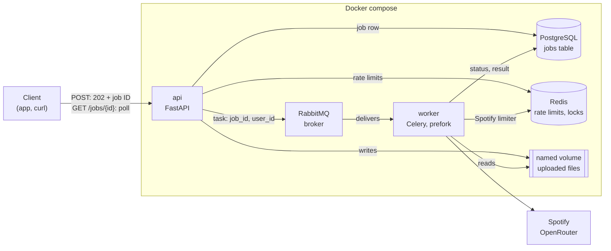
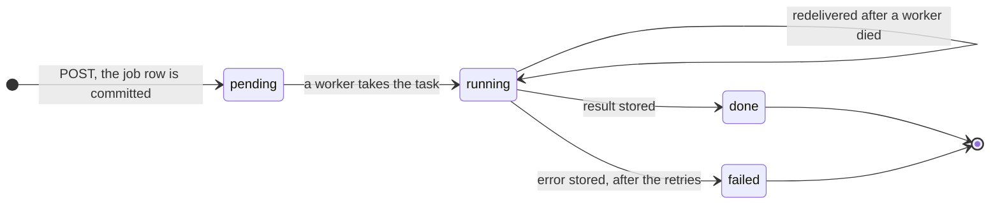
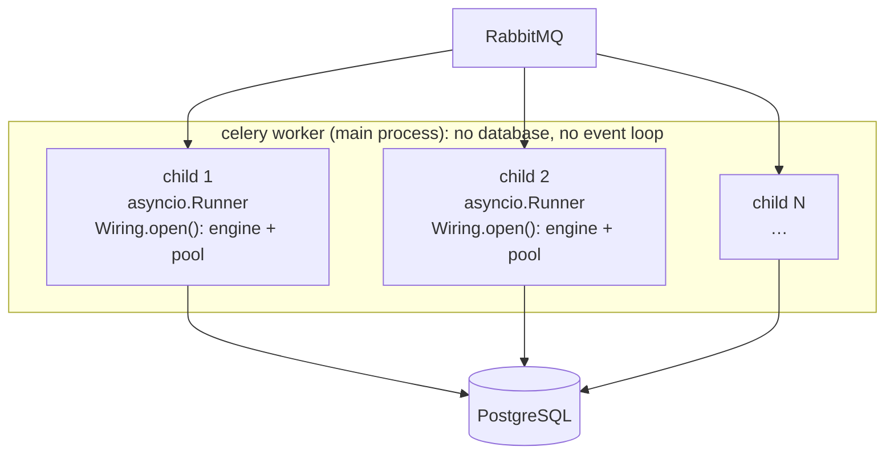

# API and workers

MuseFlow is a single-user CLI. Epic #271 opens it to a few users (Spotify's development mode caps the app at a
handful) through the API, with the long flows (enrichment, taste profile build, playlist creation, history import)
running as background jobs on Celery workers. It is a learning showcase: a production-like stack (FastAPI, Celery,
RabbitMQ, Redis) rather than the leanest one.

This page holds the decisions every sub-issue of the epic relies on, so that each one works from the same choices
instead of the issue threads. The epic is built on the `feat/api-workers` branch; each section names the sub-issue
that builds its part.

<div class="seq-legend">
  <span><i></i>Call between programs</span>
  <span><i class="fail"></i>Fails, or is refused</span>
</div>

## At a glance



| Concern | Choice | Rejected, and why |
|---|---|---|
| Task queue | Celery 5.7 (supports Python 3.14) | A custom queue: retries, acknowledgements and dead letters to rewrite. Lighter queues (arq, Dramatiq, Taskiq): Celery is what most job offers and codebases name |
| Broker | RabbitMQ | Redis as a broker: a task survives a dead worker only through a visibility timeout to tune against the longest task, where RabbitMQ redelivers an unacknowledged message as soon as the connection drops |
| Shared state between processes | Redis: rate limits (#264), the Spotify limiter (#268), locks | PostgreSQL: possible, but a counter written on every request belongs in memory with a TTL |
| Job state | A `jobs` table in PostgreSQL (#261) | A Celery result backend: see [below](#the-jobs-table-is-the-source-of-truth) |
| Files | `FileStoragePort` on a named volume (#249, #260) | A cloud bucket now: a cost for a few users; it is one more adapter later |
| Services | One application, three entrypoints | Microservices: out of scope, see [lessons learned](../product/lessons-learned.md#if-it-grew-services-not-one-app) |

## The jobs table is the source of truth

A long flow can't run inside an HTTP request: it takes minutes, the client may leave, and a redeployment would cut it.
The API records the job, queues a task and answers at once; the client then polls the job.

- **`POST` answers `202 Accepted`** with the job ID (and a `Location: /api/v1/jobs/{id}` header). The client polls
  `GET /jobs/{id}` until the job is `done` or `failed`; `GET /jobs` lists the user's jobs, paged.
- **No Celery result backend.** Celery's results are keyed by task ID, expire, and know nothing of users. The `jobs`
  table holds what the client asks for: the user, the kind, the status, the input, the result (the use case's report)
  or the error, and the timestamps. It is queried like any other table and scoped to the current user. Tasks run
  with `ignore_result=True`.
- **No SSE nor progress percentage.** A job is short enough to poll every few seconds, and a percentage needs a
  total known in advance, which most flows (discovery rounds, LLM batches) don't have. Progress goes to the logs
  ([below](#progress-goes-to-the-logs)).
- **One job of a kind at a time per user.** A partial unique index on `(user_id, kind)`, restricted to the `pending`
  and `running` statuses, refuses a second one: a domain error, `409 Conflict`. Two enrichments of the same tracks
  would pay the LLM twice.
- **A task message carries IDs only** (`job_id`, `user_id`), never a serialised entity. The task reloads what it
  needs, so a redelivered message never runs on stale data, and the message never holds a token or a profile.



### One job, end to end

The first job, enrichment (#262), sets the pattern every other job copies.

<div class="seq">
<script type="application/json">
{
  "lanes": [
    {"id": "client", "name": "Client", "sub": "app, curl", "color": "grey"},
    {"id": "api", "name": "API", "sub": "FastAPI", "color": "teal"},
    {"id": "db", "name": "PostgreSQL", "sub": "museflow_job", "color": "indigo"},
    {"id": "mq", "name": "RabbitMQ", "sub": "task queue", "color": "amber"},
    {"id": "worker", "name": "Worker", "sub": "Celery task", "color": "teal"},
    {"id": "llm", "name": "OpenRouter", "sub": "paid LLM calls", "color": "green"}
  ],
  "steps": [
    {"phase": "Queue, inside the request"},
    {"from": "client", "to": "api", "text": "<code>POST /api/v1/tracks/enrichment</code> (config)", "detail": "Bearer access token"},
    {"note": "api", "style": "check", "text": "A paid job: within the user's LLM budget? (#263)"},
    {"from": "api", "to": "db", "text": "<code>INSERT</code> the job, <code>pending</code>, then commit", "detail": "Committed before the publish: a worker must find the row"},
    {"from": "db", "to": "api", "text": "A job of this kind is already pending or running", "style": "fail", "detail": "The partial unique index refuses it: <code>409 Conflict</code>"},
    {"from": "api", "to": "mq", "text": "Publish the task <code>(job_id, user_id)</code>", "detail": "IDs only, never an entity nor a token"},
    {"from": "api", "to": "client", "text": "<code>202 Accepted</code>, the job ID", "detail": "<code>Location: /api/v1/jobs/{id}</code>"},
    {"phase": "Run, in a worker"},
    {"from": "mq", "to": "worker", "text": "Delivers the message", "detail": "One at a time per process (prefetch 1), acknowledged at the end (acks late)"},
    {"from": "worker", "to": "db", "text": "Block: the job is <code>running</code>, the user reloaded", "detail": "A job already <code>done</code>: a redelivery, nothing to do"},
    {"from": "worker", "to": "llm", "text": "The use case runs: LLM batches outside any transaction", "detail": "Each batch committed in its own block, as on the CLI"},
    {"note": "worker", "style": "check", "text": "Killed mid-run: the message was never acknowledged", "detail": "RabbitMQ redelivers it; the job resumes from its committed checkpoints"},
    {"from": "worker", "to": "db", "text": "Block: <code>done</code>, the report as the result"},
    {"from": "worker", "to": "db", "text": "Or, after the retries: <code>failed</code>, with an error fit for the user", "style": "fail", "detail": "Transient errors only are retried, with backoff; then the dead-letter queue"},
    {"from": "worker", "to": "mq", "text": "Acknowledges the message"},
    {"phase": "Poll"},
    {"from": "client", "to": "api", "text": "<code>GET /api/v1/jobs/{id}</code>, every few seconds"},
    {"from": "api", "to": "db", "text": "<code>SELECT … WHERE id = … AND user_id = …</code>", "detail": "Another user's job is a 404, as an unknown one"},
    {"from": "api", "to": "client", "text": "The status, then the result or the error"}
  ]
}
</script>
</div>

### Delivery and retries

- **At least once.** `acks_late` acknowledges a message once the task is over, not when it is received: a worker that
  dies mid-task leaves its message to another worker. The price is that a task may run twice, so **every task is
  idempotent**: it checks the job status first, and the use cases already resume from their checkpoints (enrichment,
  profile build, history import chunks).
- **Retries for transient errors only**, with an exponential backoff and jitter: the database or the network
  unreachable (`TRANSIENT_ERRORS` in `entrypoints/worker/main.py`), `MUSEFLOW_WORKER_TASK_MAX_RETRIES` times (5),
  each wait capped at `MUSEFLOW_WORKER_TASK_RETRY_BACKOFF_MAX_SECONDS` (600). The adapters already retry their own
  HTTP calls (tenacity); a task does not retry a domain error, which would fail the same way.
- **Two ways to lose a worker.** The whole worker dies (a crash, a redeploy killing the container): its connection
  drops and RabbitMQ redelivers the message, flagged `redelivered`. Only the process running the task dies (the
  out-of-memory killer): the worker stays up, sees the process lost and retries the task like a transient error
  (`task_retry_on_worker_lost`), up to the same limit. A plain requeue would loop forever on a task that kills its
  process every time.
- **A dead-letter queue**, `museflow.dead_letter`, keeps the messages of the failed tasks: after their retries, or at
  once for an error not worth one (`task_acks_on_failure=False` rejects them, and RabbitMQ moves them there). They are
  inspected in the RabbitMQ UI (`http://localhost:15672`) or with `make broker-dead-letters` instead of being lost. The worker declares it when it
  starts, as no worker consumes it.
- **RabbitMQ's consumer timeout** (30 minutes by default) closes the channel of a message left unacknowledged longer
  than that, which `acks_late` does for a long task. The longest job, a first enrichment, took 8 minutes for 10,000
  tracks (51 LLM batches of 200): the `museflow` queue raises it to 2 hours (`x-consumer-timeout`), room for a
  library several times larger and for slow LLM retries.

### Open point: the job row and the message

Committing the row and publishing the message are two writes to two systems, with no transaction across them (the
*dual write* problem). The order above, commit then publish, guarantees a worker finds the row; but if the publish
fails, or the API dies between the two, the job stays `pending` with no message, and the unique index refuses every
new job of its kind. #261 settles it; the leading option: the API marks the job `failed` when the publish raises,
and a `pending` job older than a threshold no longer blocks a new one. The textbook answer, a *transactional outbox*
(the message written in the same transaction as the row, then relayed to the broker), stays for later.

## The worker is a third entrypoint

The worker sits next to the CLI and the API under `infrastructure/entrypoints/` (#260): like them, it parses its
input (the task message), builds its adapters from the shared `Wiring`, and calls a use case. A task holds no logic.



- **Prefork pool, sync tasks.** Celery runs a task as a plain function. Each child process opens one
  `asyncio.Runner` in `worker_process_init` and keeps it for its life; a task runs its coroutine on it
  (`runner.run(...)`). `worker_process_shutdown` closes it.
- **The engine is created in the child, not at import (#247).** A pool of connections is bound to the event loop that
  opened it, and a socket must not cross a `fork`. `Wiring.open()` is entered in the child's runner, so each child
  holds its own engine; the same process resource feeds every task of that child, as the CLI's does for one command.
  `asyncio.run()` per task would rebuild the pool every time.
- **The connection budget.** Every child holds a pool: the database sees up to
  *children × (`DATABASE_POOL_SIZE` + `DATABASE_MAX_OVERFLOW`)* connections from the workers, plus the API's. A
  child runs one task at a time, which needs one connection for the use case and one for a provider token refresh:
  the `worker` service of Docker Compose sets a pool of 2 plus 1 overflow, and `MUSEFLOW_WORKER_CONCURRENCY` 2
  children, so 6 connections, next to the API's 15, well within PostgreSQL's 100. A second worker, or more children,
  adds 3 connections each.
- **One user's flow, the same use case.** A task calls the use case the CLI calls, with the same unit of work rules
  ([Unit of work](unit-of-work.md)): no transaction open during an LLM or Spotify call. The task is a thin sync
  function that runs a coroutine on the process's loop, as a CLI command runs its logic:

```python
@celery_app.task(name="tracks.history_import")
def import_history_task(job_id: str, user_id: str) -> None:
    run_task(_import_history(uuid.UUID(job_id), uuid.UUID(user_id)))


async def _import_history(job_id: uuid.UUID, user_id: uuid.UUID) -> None:
    wiring = get_wiring()  # the wiring of the process, opened in worker_process_init
    ...
```

## Progress goes to the logs

The use cases publish progress events through `ProgressPort` (the CLI renders them with Rich). The worker passes
`LogProgressAdapter`, which writes each event to the logs at `INFO` (`MUSEFLOW_LOG_LEVEL_WORKER`, `INFO` by
default): an operator follows a job with `docker compose logs worker`, or in the JSON log handler's output with the
data in `extra` ([Logging & output](logging.md)). A step that advances chunk by chunk logs at `DEBUG`, with an
`INFO` line every 30 seconds at most; counts only, never the user's tracks or artists. Not a no-op: a job that
runs for minutes without a trace can't be told from a stuck one. The client sees the status only; the trace of a
request across the API, the broker and the worker comes with OpenTelemetry (#269).

## Files go through the storage port

An upload (the streaming history export, #265) can't travel in a task message: a message stays small. The API
writes the files through `FileStoragePort` (#249), keyed per user (`history/<batch>/file.json`), and the message
carries the key. `LocalFileStorage` keeps a directory per user under `MUSEFLOW_FILE_STORAGE_DIR`, on a named Docker
volume mounted by both `api` and `worker`. A cloud bucket is one more adapter of the same port when the app is hosted
somewhere without a shared disk. The task deletes the files once the import is committed.

## API conventions

Set by #252 before the routes of every theme, so that they all answer the same way.

### Errors: problem details (RFC 9457)

Exception handlers registered on the app map each domain exception to a status code; the routes drop their own
`try/except`. The body is a *problem details* object, `Content-Type: application/problem+json`:

```json
{
  "type": "about:blank",
  "title": "Conflict",
  "status": 409,
  "detail": "A track enrichment is already running.",
  "instance": "/api/v1/tracks/enrichment"
}
```

| Status | When |
|---|---|
| `400` / `422` | A malformed request (FastAPI's validation keeps `422`) |
| `401` | No valid access token |
| `404` | Not found, **or another user's**: a client never learns that an ID exists |
| `409` | A conflict with the current state: a job of this kind already running, a duplicate name |
| `429` | A rate limit (#264), with `Retry-After` |
| `500` | Anything unmapped: a generic body, the traceback in the logs only |

The status of the LLM budget refusal (`429` or `402`) is decided in #263; whichever it is, the body never states an
amount.

### Pagination: offset, then cursor where a collection grows

- **Offset by default.** `limit` and `offset` query parameters, bounded, shared by the routes; a generic `Page[T]`
  response schema: `items`, `total`, `limit`, `offset`. The repository takes `limit` / `offset` in `get_list` and
  counts the total: no `fastapi-pagination`, the query stays in the repository.
- **Cursor (keyset) for the tracks (#259).** A user's tracks reach thousands of rows. An offset re-reads every skipped
  row and shifts when rows are inserted between two pages; a cursor resumes after the last row read:
  `WHERE (sort_key, id) > (:key, :id) ORDER BY sort_key, id LIMIT :n`, backed by a matching index. The cursor is
  opaque to the client, and the response has a `next_cursor` instead of a `total`.

```json
{"items": [], "total": 134, "limit": 20, "offset": 40}
{"items": [], "next_cursor": "eyJrIjoi4oCmIiwiaWQiOiLigKYifQ"}
```

## What stays out

- **Microservices**: one application, three entrypoints. The ports are where it would split.
- **A Celery result backend, SSE, progress percentages**: the jobs table and polling cover the need.
- **Migrations in production**: the single `initial` migration is still regenerated during development
  ([Data model](data-model.md)); a handful of family users can re-import.
