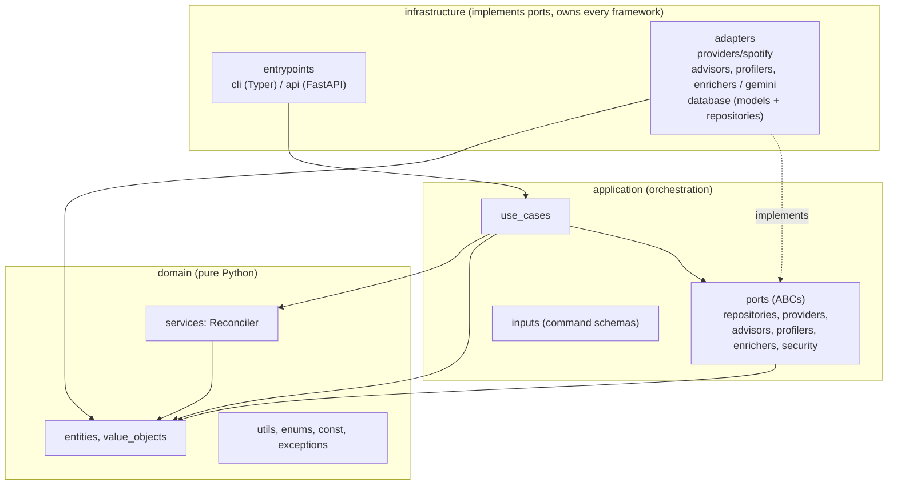
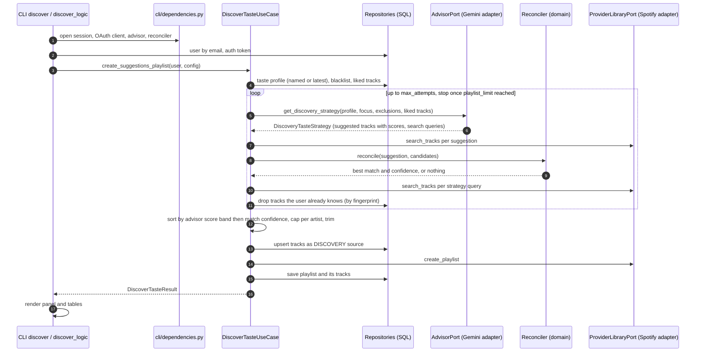

# Architecture

MuseFlow follows Clean / Hexagonal Architecture. The reason is practical rather than ceremonial: the product depends on three things that change independently and fail independently, namely a streaming provider (Spotify today), an LLM vendor (Gemini today), and a database. Each sits behind a port, so the use cases and the matching logic can be tested without any of them and the vendors can be swapped by adding an adapter.

## Layers and the dependency rule

| Layer | Path | May import | Contains |
|---|---|---|---|
| Domain | `museflow/domain/` | the standard library and a few pure helpers (`rapidfuzz`, `unidecode`) | Frozen-dataclass entities, value objects, the `Reconciler` service, enums, constants, exceptions |
| Application | `museflow/application/` | domain only | Use cases, input schemas, port interfaces (`abc.ABC`) |
| Infrastructure | `museflow/infrastructure/` | everything | SQLAlchemy models and repositories, Spotify and Gemini adapters, settings, Typer and FastAPI entrypoints |

Two points are easy to miss:

- **The domain contains a service, not only data.** The `Reconciler` ([`museflow/domain/services/reconciler.py`](https://github.com/ychab/museflow/blob/main/museflow/domain/services/reconciler.py)) decides whether an LLM suggestion and a catalogue track are the same recording. That is a business rule, it has no I/O, and it is deterministic, so it lives in the domain and is injected into the use case.
- **Ports are defined by the application, not by the infrastructure.** For example `AdvisorPort` ([`museflow/application/ports/advisors/agent.py`](https://github.com/ychab/museflow/blob/main/museflow/application/ports/advisors/agent.py)) exposes `get_discovery_strategy(...)` in domain terms (`TasteProfile`, `Track`, `DiscoveryFocus`) and returns a `DiscoveryTasteStrategy`. Nothing in it mentions HTTP or JSON.

## Ports and adapters

| Port (application) | Adapter (infrastructure) |
|---|---|
| `ProviderLibraryPort` (search, create / delete playlist, play) | `SpotifyLibraryAdapter`, built by `SpotifyLibraryFactory` |
| `ProviderOAuthPort` | `SpotifyOAuthAdapter` |
| `StreamingHistoryPort` (parse an export file) | `SpotifyStreamingHistoryAdapter` |
| `AdvisorPort` | `GeminiAdvisorAdapter` |
| `TasteProfilerPort` | `GeminiTasteProfileAdapter` |
| `TrackEnricherPort` | `GeminiTrackEnricherAdapter` |
| `TrackRepository`, `PlaylistRepository`, `TasteProfileRepository`, `BlacklistRepository`, `UserRepository`, OAuth token and state repositories | `*SQLRepository` classes over an injected `AsyncSession` |
| `PasswordHasherPort`, `StateTokenGeneratorPort`, `AccessTokenManagerPort` | Argon2, a `random.SystemRandom` state-token generator, PyJWT |

Where the vendor is already an enum (`MusicProvider`, `MusicAdvisor`, `TasteProfiler`), the CLI picks the adapter with a `match` in [`dependencies.py`](https://github.com/ychab/museflow/blob/main/museflow/infrastructure/entrypoints/cli/dependencies.py). Adding a provider means one new `case` plus the adapter package. A `/new-provider` command in `.claude/commands/` encodes that checklist.

MuseFlow is deliberately a single application. If it grew, the ports above are where it would split into services (import, profiling, recommendations and playlists, enrichment); the trade-off is discussed in [lessons learned](../product/lessons-learned.md#if-it-grew-services-not-one-app).

## One flow end to end: `playlist discover`

The most connected command. It touches every port.

What the diagram encodes, with the reasoning behind each step:

1. **Composition happens in the entrypoint.** `discover_logic` opens the DB session and each adapter inside an `AsyncExitStack`, so every HTTP client is closed even on failure, then hands finished objects to the use case. The use case never instantiates a repository or a client.
2. **The advisor is asked several times.** The first answer rarely survives filtering (unreconciled, already known, blacklisted), so the use case loops up to `--max-attempts`, passing everything suggested so far as an exclusion list. Each attempt is reported (`suggested / survived / new`) so the user can see where candidates were lost.
3. **Two sources of candidates.** Suggestions are reconciled against the catalogue; the strategy's free-text search queries are also run, with a fixed advisor score of 0.8 and reconciler score of 1.0 (a constant in the use case, see [`taste_discover.py`](https://github.com/ychab/museflow/blob/main/museflow/application/use_cases/taste_discover.py)).
4. **"Known" is decided by fingerprint**, not by provider id, so a re-release or a different catalogue entry of a track the user already played is still excluded (see [Data model](data-model.md)).
5. **Ordering is banded.** Tracks are sorted by advisor score rounded down to a band (`DISCOVERY_SCORE_BAND_WIDTH`, default 0.05), then by reconciliation confidence within the band. Banding stops tiny, meaningless score differences from outranking a more certain catalogue match.
6. **Side effects come last and are not atomic.** Discovery tracks are upserted first (so they are excluded from future sessions), then the remote playlist is created, then the local playlist row is saved. See [Known gaps](privacy-and-data.md#known-gaps).

## Conventions and why they exist

The rules are written down in [`CONVENTIONS.md`](https://github.com/ychab/museflow/blob/main/CONVENTIONS.md) (detailed reference) and [`CLAUDE.md`](https://github.com/ychab/museflow/blob/main/CLAUDE.md) (the short contract loaded into every AI session, see [AI-assisted development](ai-assisted-development.md)). The ones that shape the code most:

| Convention | Reason |
|---|---|
| Entities are `@dataclass(frozen=True, kw_only=True)`; validation only in `__post_init__`; computed permanent fields (the track fingerprint) set there with `object.__setattr__` | Immutability removes a class of aliasing bugs; no framework means domain tests need no fixtures; business invariants (a track has a name, an artist and a provider link) fail at construction |
| No database limits in the domain (no `varchar(255)` checks) | A storage concern must not leak into business rules |
| Ports are ABCs that accept input schemas and return entities | Use cases stay framework-free and are tested with `AsyncMock` instead of fakes |
| SQLAlchemy models are `MappedAsDataclass` with symmetric `from_entity` / `to_entity` | One place maps each direction, repositories never build models field by field. Every model implements `to_entity`; `from_entity` exists on the two models whose repositories write whole entities (`Track`, `Playlist`), although the contract asks for both everywhere |
| Use cases are plain async functions; a class only when injected state is needed (for example `DiscoverTasteUseCase`) | Function by default, class when the constructor genuinely carries dependencies |
| Parameters grouped by role: inputs, then repositories, then other ports; DI parameters contiguous | Callers use keywords, so order is documentation; a consistent order makes a signature scannable |
| CLI commands are thin sync wrappers around an `asyncio.run()` of a `<command>_logic` coroutine; the logic returns data and never prints | Output stays in the callback, so logic is unit-testable without capturing stdout, and the same logic can be reused |
| `HttpClientMixin` first, port second in the base class list (`class GeminiAdvisorAdapter(HttpClientMixin, AdvisorPort)`) | The mixin supplies concrete methods (`close`, the async context manager) that the port declares abstract. With the port first, Python's MRO would find the abstract version first and the class could not be instantiated. |
| Repeated closures are centralised as decorators (`@self_heal`, `@validate_response`, tenacity's `@retry`) | Three Gemini adapters share the same failure handling; copy-paste would drift |

!!! note "Known deviations from the stated rules"
    The rules above are enforced by review (human and agent), not by tooling, and a few exceptions exist. `CLAUDE.md` bans `assert` in production code, yet [`taste_discover.py`](https://github.com/ychab/museflow/blob/main/museflow/application/use_cases/taste_discover.py) uses `assert strategy is not None` after the loop and [`database/session.py`](https://github.com/ychab/museflow/blob/main/museflow/infrastructure/adapters/database/session.py) asserts on the database URI at import time. `CLAUDE.md` also describes mypy as strict, while `pyproject.toml` configures mypy with the Pydantic plugin but without `strict = true` (see [Quality & testing](quality.md)).
