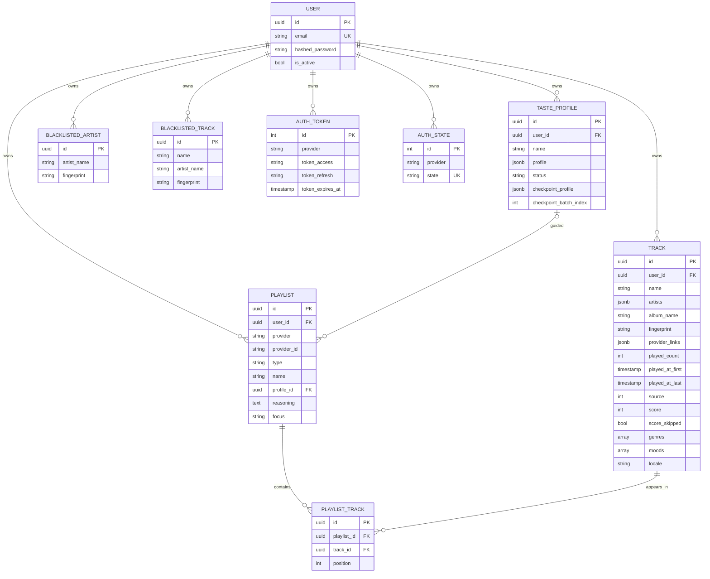

# Data model

PostgreSQL only, by design: the schema uses `JSONB`, `ARRAY`, `ON CONFLICT DO UPDATE` and `xmax`-based insert detection, and none of that is hidden behind a portable abstraction. Tables are prefixed `museflow_`. Every user-owned table has a `user_id` foreign key with `ON DELETE CASCADE`, so deleting a user removes all of their data.

The diagram omits audit columns (`created_at`, `updated_at`, provided by a mixin) and a few Playlist columns (`snapshot_id`, `genre`, `mood`, `custom_instructions`). Models live in [`museflow/infrastructure/adapters/database/models/`](https://github.com/ychab/museflow/tree/main/museflow/infrastructure/adapters/database/models); the matching frozen-dataclass entities live in [`museflow/domain/entities/`](https://github.com/ychab/museflow/tree/main/museflow/domain/entities).

## Track: one row per distinct track, not per play

A streaming-history export is an event log: one line per play. MuseFlow aggregates it at import time into **one row per track** carrying `played_count`, `played_at_first` and `played_at_last`.

| Option | Rows for the author's history | Trade-off |
|---|---|---|
| One row per play | ~228,000 | Keeps full time series; every query aggregates; far too much for an LLM prompt |
| **One row per track (chosen)** | ~11,300 after filtering | Loses the exact play timeline, keeps what the product needs: how much, since when, until when |

The ~228k and ~11k figures come from the author's own export (see [What my data taught me](../product/insights.md)). The aggregation is also what makes the history small enough to send to an LLM in batches (see [LLM pipeline](llm-pipeline.md)). Two import filters shrink the data further: plays shorter than the minimum duration (`--min-duration-played`, default 90 seconds in the CLI) are skipped, and so are entries with no timestamp or no Spotify track id (counted in the import report).

Re-import is idempotent. `TrackRepository.bulk_upsert` ([source](https://github.com/ychab/museflow/blob/main/museflow/infrastructure/adapters/database/repositories/track.py)) uses `INSERT ... ON CONFLICT (user_id, fingerprint) DO UPDATE` with per-column merge rules:

| Column | On conflict |
|---|---|
| `played_at_last` | `GREATEST(existing, incoming)` |
| `played_at_first` | `LEAST(existing, incoming)` |
| `source` | bitwise OR, so a track found in history and later suggested keeps both flags |
| `score` | keep existing unless null (`COALESCE`), a re-import never overwrites a rating |
| `provider_links` | JSONB concatenation |
| `played_count` | replaced by the incoming count (the import recomputes it from the files) |
| `score_skipped`, `genres`, `moods`, `locale` | **never updated**, so user decisions and enrichment survive a re-import |

The last row is a deliberate asymmetry: derived data from the import may be refreshed, human or LLM-added data may not. The restore path for ratings and enrichment is the `rate` and `enrich` export / import commands, not the importer.

### Identity: the fingerprint

A track is identified by a **fingerprint**, not by a provider id: `normalize(name)|normalize(primary_artist)` ([`museflow/domain/utils/text.py`](https://github.com/ychab/museflow/blob/main/museflow/domain/utils/text.py)). Normalisation transliterates to ASCII, lowercases, strips bracketed `feat` / `remaster` / `live` / `edit` / `version` suffixes and punctuation. For example `My Song (Remastered 2011)` by `Some Artist` becomes `my song|some artist`.

Why not the provider id:

- **Cross-provider identity.** The same recording has different ids on different providers. `provider_links` is a JSONB list of `{provider, provider_id}` pairs, so one row can carry several.
- **Re-releases.** The same song appears under several Spotify ids (single, album, remaster). History import collapses them (their play times are merged) and the discovery filter excludes anything whose fingerprint is already known.
- **Blacklist and ratings follow the song**, not one catalogue entry.

The cost is false merges (two different songs with the same normalised title and primary artist) and false splits (spelling variants). The fingerprint is computed in the entity's `__post_init__` and indexed; the unique constraint is `uq_museflow_track_user_fingerprint` on `(user_id, fingerprint)`.

!!! note "Uniqueness evolved"
    Commit `8b27c95` first made the constraint `(user_id, provider, fingerprint)`; `edb1fd9` ("splitting providers") replaced it with `(user_id, fingerprint)` plus the `provider_links` list. The provider is therefore not part of uniqueness today.

### Source, score and skip flags

| Field | Meaning |
|---|---|
| `source` | `TrackSource` is an `IntFlag` stored as an integer: `HISTORY = 1`, `DISCOVERY = 2`. A bit field rather than an enum so one track can be both (imported from history, or suggested then later heard) without a join table |
| `score` | Optional rating, `0` to `10` (`DISCOVERY_TRACK_SCORE_MIN/MAX`). `0` means actively disliked; an interactive rating that is at or below `DISCOVERY_BLACKLIST_SCORE_THRESHOLD` (3) prompts the user to blacklist the track and its artist, tracks at or above `DISCOVERY_LIKED_SCORE_THRESHOLD` (7) feed the advisor as taste anchors, capped by `DISCOVERY_LIKED_TRACKS_LIMIT` (200) |
| `score_skipped` | The user chose not to rate this track and not to be asked again |
| `genres`, `moods`, `locale` | Enrichment output (below). Postgres `ARRAY(String)` for the lists, ISO 639-1 code for the language |

Discovery tracks are written to the same table (with zeroed play data) so they are excluded from later sessions by the same fingerprint check as played tracks.

### Genre and mood vocabularies

Free-text tags from an LLM are not queryable or comparable, so enrichment and profiling are constrained to closed vocabularies defined in [`museflow/domain/enums.py`](https://github.com/ychab/museflow/blob/main/museflow/domain/enums.py) and grouped in [`museflow/domain/const.py`](https://github.com/ychab/museflow/blob/main/museflow/domain/const.py).

| Vocabulary | Size | Shape |
|---|---|---|
| `GenreTag` macro | 13 | Broad umbrella, for example `hip-hop`, `electronic`, `rock`, `jazz`, `world` |
| `GenreTag` meso | 60 | Sub-genre of a macro, for example `house`, `post-rock`, `neo-soul` |
| `GenreTag` micro | 93 | Finest level, optional |
| `MoodTag` | 12 | `energetic`, `chill`, `melancholic`, `upbeat`, `aggressive`, `romantic`, `focus`, `party`, `introspective`, `euphoric`, `peaceful`, `dark` |

A track's `genres` list is ordered `[macro, meso, micro?]`, so the first element is always the broadest class and the list is usable at any granularity without a separate column per level. The taxonomy is one flat enum with the level encoded by tuple membership (`GENRE_MACRO_TAGS`, `GENRE_MESO_TAGS`, `GENRE_MICRO_TAGS`), which keeps the stored value a plain string and lets a taxonomy change be handled by re-enriching (`enrich tracks --force`) rather than by a migration.

## Playlist: one entity, a type discriminator

`museflow_playlist` stores both kinds of playlists in one table with a `type` column (`PlaylistType`): `DISCOVERY` (AI-curated) and `HISTORY` (a persisted "best of" from the user's own library). They were once two separate concepts (an ephemeral playlist and a persisted discovery playlist) and were merged (commit `467a4ce`) so a new type does not need a new table. Columns specific to discovery (`profile_id`, `reasoning`, `focus`, `genre`, `mood`, `custom_instructions`) are nullable and set only for that type, recording *why* the playlist exists. Membership and order live in `museflow_playlist_track` (`position`).

`profile_id` references the taste profile with `ON DELETE CASCADE`, so **deleting a taste profile also deletes the discovery playlists it guided**.

## Taste profile

`museflow_taste_profile` holds one named profile per user (`UNIQUE (user_id, name)`). The profile itself is a `JSONB` document typed by the `TasteProfileData` TypedDict in the domain:

| Section | Content | Produced by |
|---|---|---|
| `taste_timeline` | List of eras: label, time range, a five-value technical fingerprint (energy, acousticness, rhythmic complexity, atmosphere, instrumentalness), dominant moods | segment + merge |
| `core_identity` | Long-term affinities, tag to weight in `[0, 1]` | segment + merge |
| `current_vibe` | What the latest batch reveals right now | segment + merge (replaced each time) |
| `personality_archetype`, `life_phase_insights`, `musical_identity_summary`, `behavioral_traits`, `discovery_style` | Narrative and numeric traits | final reflection |

Document storage fits because the profile is read and written as a whole, never queried by section, and its shape is owned by a prompt that will keep evolving. `logic_version` and `profiler_metadata` (the model names used) are stored beside it so a profile can be traced to the code and models that produced it.

**Checkpointing** reuses the same row. While a build runs, each completed batch upserts the partial profile into `profile`, sets `status = BUILDING`, and records `checkpoint_profile` and `checkpoint_batch_index`. `--resume` reads the checkpoint and continues from the next batch. On completion the row becomes `FINISHED` and the checkpoint columns are cleared. `discover` refuses a profile that is still `BUILDING`.

## Blacklist and authentication

- **Blacklist.** Two tables, `museflow_blacklisted_artist` and `museflow_blacklisted_track`, each unique on `(user_id, fingerprint)`. An artist fingerprint is just the normalised name; a track fingerprint is the same `name|artist` form as `museflow_track`. They are enforced twice at discovery time: sent to the advisor as "never suggest", and re-applied after reconciliation in case the advisor ignored the instruction.
- **Users.** `email` (unique) and an Argon2 password hash. The API issues JWT access tokens (HS256, 30 minutes by default); the CLI identifies a user by `--email` and does not authenticate.
- **Provider tokens.** `museflow_auth_token` stores the Spotify access and refresh token per `(user, provider)`, and `museflow_auth_state` stores the single-use OAuth `state`. Tokens are stored as plain strings in the database (see [Privacy & data](privacy-and-data.md)).

## Migrations

The project keeps a single squashed Alembic migration (`migrations/versions/initial.py`), edited in place during V2 development, consistent with a reset-and-re-import workflow rather than data-backfill migrations (commit `2fdd158` squashed the earlier ones). That is fine for a single-user project and would need to change before any multi-user deployment.
