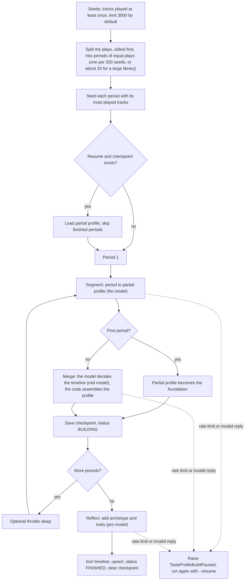

# LLM pipeline

Three components use a language model, and each sits behind a port so the use cases never see a vendor, a prompt or a JSON payload:

| Component | Port | Where | Job |
|---|---|---|---|
| Profiler | `TasteProfilerPort` | `adapters/profilers/openrouter/` | Condense a listening history into a structured taste profile |
| Advisor | `AdvisorPort` | `adapters/advisors/openrouter/` | Pick artists for the user, then tracks among their catalogue the user does not know, guided by the profile |
| Enricher | `TrackEnricherPort` | `adapters/enrichers/openrouter/` | Tag tracks with genres, moods and language |

A design stance runs through all of them: **the model proposes, deterministic code disposes.** Output is constrained by a JSON response schema, validated by Pydantic, restricted to closed vocabularies, chosen among the real catalogue, and filtered against what the user already knows or has blacklisted. The model never writes to the database or to the provider directly.

## Gateway: OpenRouter

Every LLM call goes through [OpenRouter](https://openrouter.ai), an OpenAI-compatible gateway in front of many model vendors. The three adapters share one `OpenRouterClient` ([`common/llm/client.py`](https://github.com/ychab/museflow/blob/main/museflow/infrastructure/adapters/common/llm/client.py)), built by composition, which owns the HTTP envelope, the retries and the reply parsing. An adapter only holds its prompts, its response schema and the settings of its steps.

Each request carries:

- **A strict JSON schema** (`response_format: json_schema`, `strict: true`), built with `JsonSchemaProperty` ([`common/llm/json_schema.py`](https://github.com/ychab/museflow/blob/main/museflow/infrastructure/adapters/common/llm/json_schema.py)): `additionalProperties: false` on every object, every property required, optional values expressed as nullable types. Strict mode forbids free-form keys, so the profile's `{tag: weight}` maps travel as lists of `{key, value}` pairs, one list per vocabulary tier (`genre_macro`, `genre_meso`, `genre_micro`, `mood`); the reflect prompt embeds the profile in that same shape, so the model reads what it must write back.
- **Provider preferences**: `require_parameters: true`, so OpenRouter only routes to endpoints that support structured outputs and every tuning parameter the step sends; `zdr: true` (Zero Data Retention, `OPENROUTER_ZDR`, on by default) and `data_collection: deny`, see [Privacy and data](privacy-and-data.md).
- **Fallback models**, tried in order by OpenRouter when the main model fails. The model that actually answered is logged at DEBUG.

**Fail fast on a misconfigured model.** Before any paid call, each command checks its step models (and their fallbacks) against OpenRouter's public model catalog: an unknown id fails with a "Did you mean" suggestion, a model that lacks a parameter the step sends (structured outputs, reasoning, temperature, max tokens) fails with the missing list, and a model that does not accept the step's reasoning effort fails with the efforts it accepts (the catalog's `reasoning.supported_efforts`; a model listed without them is not checked). With ZDR on, it also reads the public list of Zero Data Retention endpoints (`GET /endpoints/zdr`): a model with no ZDR endpoint, or whose ZDR endpoints lack one of those parameters, fails before any paid call too. Without that check, OpenRouter only refuses it on the first completion, with a 404 "No endpoints found matching your data policy". The check remains a necessary condition: OpenRouter picks the endpoint at request time.

## Portable response schemas

Any step can run on any model, so a response schema must be accepted by every provider behind OpenRouter, not only by the default one. Provider rejections taught three rules, which `JsonSchemaProperty` enforces and a unit test (`test_schema_portability.py`) checks on every real schema:

- **An enum holds at most 100 values.** Gemini rejects a larger one with a bare `400 INVALID_ARGUMENT`. A larger vocabulary is split across fields, which is why genres travel as one field (or one weight list) per tier.
- **`anyOf` does not get around the limit:** Gemini adds up the values of every branch.
- **A nullable enum is `anyOf [enum, null]`.** The OpenAI shape, `type: ["string", "null"]` with an `enum`, is rejected by Anthropic.

The live suite (`tests/integration/live/openrouter`) sends the real schemas to a few model families before a release.

## Model choice per step

Each step has its own `LLMSettings` ([`museflow/infrastructure/config/settings/openrouter.py`](https://github.com/ychab/museflow/blob/main/museflow/infrastructure/config/settings/openrouter.py)): `MODEL`, `MAX_TOKENS`, `REASONING_EFFORT`, `TEMPERATURE` and `FALLBACK_MODELS`. `MODEL` and `REASONING_EFFORT` are required and have a default per step; the others are left to the provider. The effort is always sent because OpenRouter's reply does not say which effort a provider applied by default: an explicit one is the only way to know what a call ran at, and to record it. The defaults are each model's own default in OpenRouter's catalog (`reasoning.default_effort`), made explicit, except a low effort on the merge step. A model that does not reason cannot be used, since it rejects the `reasoning` parameter; `none` turns reasoning off on the models that accept it. Changing a step's model may require changing its effort too: not every model accepts every effort, and the check below says which. A field is overridden with a nested environment variable, and the step keeps its other defaults:

```bash
OPENROUTER_ENRICHER__MODEL=openai/gpt-5-nano
OPENROUTER_PROFILER_REFLECT__REASONING_EFFORT=high
OPENROUTER_ADVISOR__FALLBACK_MODELS=["anthropic/claude-sonnet-4.5"]
```

The CLI also overrides the model for one run: `enrich tracks --model`, `taste build --segment-model / --merge-model / --reflect-model`, `playlist discover --model`. Current defaults:

| Step | Setting | Default model | Volume | Why this tier |
|---|---|---|---|---|
| Profile segment | `PROFILER_SEGMENT` | `google/gemini-3.1-flash-lite` | One call per listening period (15 for the default 3,000 seeds in periods of 200, 20 for 10,000 seeds) | High volume, narrow task: classify the tracks of a period into tags and weights against a closed vocabulary. A small, cheap model is enough |
| Profile merge | `PROFILER_MERGE` | `google/gemini-3.5-flash` | One call per period after the first | Judges whether a segment continues the last era, and names an era when the timeline is full: a few eras in, two fields out, the code assembling the profile. A step up from the lite tier, with a low reasoning effort: on the same seeds it gave the same profile structure for 56% less than the default effort (#82) |
| Profile reflect | `PROFILER_REFLECT` | `google/gemini-3.1-pro-preview` | **One call per build** | The only step that writes narrative and judgement (archetype, life-phase insights, behavioural traits). Run once, so the most capable model is affordable |
| Advisor | `ADVISOR` | `anthropic/claude-sonnet-5.5` | Two calls per round (artists, then picks), one round per playlist in practice, `DISCOVERY_MAX_ATTEMPTS` at most (default 3) | Needs musical knowledge and instruction-following, called interactively. Chosen by ear over three Gemini models on real playlists (#163); about $0.06 a playlist since discovery picks artists first (#174). Gemini 3.5 Flash was no cheaper on that flow, as it reasons longer |
| Enricher | `ENRICHER` | `google/gemini-3.1-flash-lite` | One call per batch of 200 tracks | Pure classification into closed vocabularies, repeated over the whole library |

The principle is to spend model capability where one call has outsized influence on the result (the single reflection pass, the merge that every later step builds on) and use the cheapest tier where the work is high-volume and constrained. The defaults stay on Gemini, as before the gateway, but on 3.x models: the 2.5 Flash and Flash Lite models MuseFlow used have no Zero Data Retention endpoint, so ZDR routing refuses them. They were not benchmarked against other vendors, so treat the tiering as a reasoned default, not a measured optimum. Comparing models is now a `--model` flag away.

!!! note "Reasoning tokens count against `MAX_TOKENS`"
    On reasoning models, the hidden reasoning is billed and counted as output tokens. A low `MAX_TOKENS` can cut the JSON off (`finish_reason: length`), which fails the call as truncated. The defaults leave `MAX_TOKENS` unset for that reason.

## Profiler: periods, merge, reflect



Source: [`taste_profile_build.py`](https://github.com/ychab/museflow/blob/main/museflow/application/use_cases/taste_profile_build.py) (orchestration) and [`profilers/openrouter/client.py`](https://github.com/ychab/museflow/blob/main/museflow/infrastructure/adapters/profilers/openrouter/client.py) (prompts).

Design decisions:

- **Map, then fold, then reflect.** A 3,000-track history does not fit comfortably in one prompt and a single huge prompt is fragile. Each period is summarised independently (segment), then folded into a running profile (merge). The final reflection sees only the profile, never raw tracks.
- **Listening periods, from every play** ([`TrackPlaySQLRepository.get_periods`](https://github.com/ychab/museflow/blob/main/museflow/infrastructure/adapters/database/repositories/track_play.py), #139). The plays, oldest first, are dealt into periods holding the same number of plays (SQL `ntile`), so a dense year gets more periods than a quiet one; each period is seeded with the tracks most played *during* it, and the prompt gives each track its plays in the period and the period's dates as the era's time range. A track replayed years later seeds each period it was played in, and a track never played (a discovery not listened to) seeds none. Before, seeds were the most played tracks overall, dated by their last play only: on the author's library, 7 of 14 eras fell in the last 10 months; with periods, 20 periods of about 5,900 plays span 2017 to 2026, built from 10,160 seed slots over 4,071 distinct tracks.
- **The model judges, the code merges** ([`domain/utils/taste.py`](https://github.com/ychab/museflow/blob/main/museflow/domain/utils/taste.py)). The merge prompt carries only the last era and the segment's era, and the model answers one question: does the segment continue that era (more than 80% similar and already described by its label)? If so, the code extends the era's end date and keeps its label (a label broadened at each merge would absorb every later segment); otherwise it appends the segment's era. Past 15 eras, the code merges the two oldest (spanning time range, averaged fingerprint, moods of both), under a label the model names when the timeline is full. An era label names the music, never dates or the processing ("batch"), since dates live in `time_range` and a merge would make them stale. `core_identity` is an average weighted by plays (a period of 5,000 plays merged into a profile of 15,000 weighs a quarter), so it is the mean over the listening whatever the period size, and `current_vibe` is replaced wholesale: arithmetic the model used to do while rewriting the whole profile at every merge, which made the merge most of a build's cost. The two fields encode a product opinion: long-term identity is the whole library, current mood is the latest segment. A fixed 0.3 weight per segment, as before, kept in fact only the last few periods, more or fewer of them with their size. Every weight is rounded to 3 decimals and those that round to 0 are dropped, so later prompts do not carry noise.
- **Period size from the seed count.** Without `--batch-size`, a period holds 200 seed tracks, or the seeds split into about 20 periods when that makes them larger (10,155 seeds: periods of 508). Each period then holds about one era of the 15-era timeline: on 10,155 seeds, batches of 200 meant 50 merges, many of them forced merges of the oldest eras, which squeezed 2017 to 2024 into a single era, for $2.41; batches of 500 gave 20 merges, a timeline spread over the whole history, for $0.92.
- **No short trailing period.** Periods hold the same number of plays by construction, so none is a handful of tracks that would replace the current vibe and add an era of its own (#136).
- **User ratings are part of the signal.** Each track line carries its plays in the period and, if rated, the score. The prompt tells the model to treat high scores as confirmed anchors and minimum scores as anti-preferences.
- **Checkpoint and pause.** After every period the partial profile and period index are persisted ([Data model](data-model.md#taste-profile)). A rate-limit overrun or an unusable reply raises `TasteProfileBuildPausedError` instead of losing the run; `taste build --resume` continues from the next period, the periods being cut the same way as long as no play is imported in between. `TASTE_PROFILE_BUILD_THROTTLING_SLEEP_SECONDS` can space out periods to stay under a quota.
- **The reflect step is resumable.** The reflection result itself is not checkpointed, but the merged profile is saved after the last period. A rate-limit overrun or unusable reply in the final call also raises `TasteProfileBuildPausedError` (reported as batch N/N), and `--resume` skips every period and repeats only that final call.
- **Reproducibility metadata.** `logic_version` (currently `v2.2`, listening periods built from every play) and, in `profiler_metadata`, the gateway and the settings of each step (model, fallbacks, reasoning effort, max tokens, temperature) are stored with the profile.

## Advisor: guided discovery

Discovery takes two calls per round. The model is asked for **artists**, and only then for tracks, chosen among the
real catalogue tracks of those artists: models know niche artists far better than their discographies, so asked for
titles they invented some and kept to the genre's canon (the measure behind this choice:
[Discovery: from titles to artists](../product/discovery-by-artists.md)).

**Step 1, artists** (`get_discovery_artists`, usage step `advisor_artists`). It returns a `DiscoveryArtistStrategy`:
a reasoning paragraph, a strategy label, the artists each with the `sound` wanted from them for this playlist (era,
mood, texture), a confidence score and a `requested` flag, and a playlist name. The prompt is assembled in
[`advisors/openrouter/client.py`](https://github.com/ychab/museflow/blob/main/museflow/infrastructure/adapters/advisors/openrouter/client.py),
as a system message (the role and rules) and a user message (the session's focus and prompt), from:

| Input | Source | Purpose |
|---|---|---|
| Profile summaries | Archetype, core identity, current vibe, behavioural traits and era timeline rendered by pure helpers in `domain/utils/taste.py` | Who the listener is |
| Risk calibration | Derived from the `openness` and `adventurousness` traits: both below 0.4 means stay in the comfort zone, either above 0.7 means push into adjacent territory | How far to stray |
| Focus strategy | `expansion`, `roots_revival` or `cultural_bridge`, only the chosen one is described (`expansion` by default without a prompt, none with one; `favourite_artists` skips this step, see below); the last two interpolate the oldest and current era labels from the profile | What kind of discovery |
| Prompt | Optional CLI argument | Per-session steering: the playlist theme, in the user's words. With a prompt, a rule says what it settles over the profile: the sound it implies (a calm genre sets aside a high-energy trait), and the artists when it names a genre with its own sound; a language counts only when stated, and the profile's languages no longer break ties among the artists (#184). The profile keeps the rest, and a prompt implying no sound ("US rap") is answered from the profile alone (#177). An artist the prompt names is either the request ("tracks of Artist X I don't know": suggested with `requested` set, even if covered, and alone when the prompt names only artists) or a sound reference ("sounds like Artist X": kept out) (#200) |
| Exclusion list | The artists asked in earlier rounds of the same run | Other artists in the next round |
| Blacklist | Blacklisted artists and tracks | Hard "never suggest" |
| Liked tracks | Tracks rated 7 or more, at most 200, highest first; not filtered on the prompt | Concrete taste anchors beyond statistics |
| Disliked tracks | Tracks rated 2 or less, at most 50, lowest first (`DISCOVERY_DISLIKED_SCORE_THRESHOLD`, `DISCOVERY_DISLIKED_TRACKS_LIMIT`) | What to steer away from, beyond the blacklist |
| Covered artists | The primary artists the user owns the most tracks of, with their track count, at most 100 (`DISCOVERY_COVERED_ARTISTS_LIMIT`, 0 sends none) | A coverage, not a preference (plays and scores do not count, as the known-tracks filter drops any track of the library): a rare deep cut is welcome, most picks should come from other artists, unless the prompt asks for one of them |

**Between the calls, no LLM.** For each artist, the provider is searched by artist only
(`DISCOVERY_ARTIST_TRACKS_PAGES` pages of 10 on Spotify, the first ones holding only 5 with no track skipped, #203). A
requested artist gets a catalogue search instead (`search_artist_catalogue`): the plain search ranks by popularity, so
its first pages hold the tracks the user knows, and one query is capped around 250 tracks. Spotify's adapter runs one
`artist:"X" year:<range>` search per release year range (one range before 1980, decades, then 5-year ranges up to the
current year), `DISCOVERY_REQUESTED_ARTIST_TRACKS_PAGES` pages each, `SPOTIFY_SEARCH_CONCURRENCY` at a time. Measured
on an artist with 172 tracks in the library: 290 distinct tracks of theirs and 98 unknown to the user, against 217 and
34 for 30 pages of the plain search. Then a [strict match](#strict-artist-match) keeps the tracks crediting that
exact artist, and the tracks already in the library, blacklisted, or kept by an earlier round are dropped. A search the
provider rejects as malformed skips that artist with a warning instead of ending the run.

**Favourite artists, no step 1.** With the `favourite_artists` focus, the artists come from the user's data, with no
LLM call: `rank_favourite_artists` (`application/utils/discovery.py`) ranks the primary artists rated at or above the
user's mean first, by Bayesian average then plays, then the never-rated ones by plays; an artist rated below the mean
is left out. The best `DISCOVERY_FAVOURITE_ARTISTS_LIMIT` not blacklisted are shuffled, so that two runs start with
other artists, and each round takes the next `DISCOVERY_FAVOURITE_ARTISTS_PER_ATTEMPT`, until the playlist is full or
none is left. Their catalogue is searched as a requested artist's, but their tracks stay capped per artist: the
playlist is a mix of favourites (#200).

**Step 2, picks** (`pick_discovery_tracks`, usage step `advisor_picks`). The model gets the strategy of step 1, each
artist with its wanted sound, and the remaining tracks as `id | title | album | album release year`, then answers with
ids and a fit score. The ids are short numbers given in the prompt: the adapter maps them back to the candidates and
drops any other, so a title cannot be invented. The prompt asks to judge a track by its sound (the artist's style on
that album, in that year), never by its words, and to leave out a track it cannot place: seeing only titles, the model
had picked tracks whose title echoed the theme. A requested artist is marked in the list: no per-artist limit for them,
and their original tracks only (no remix, live or re-recording of a track the user likely knows). The profile is not sent again: the strategy carries the intent, and the
call stays cheap. With favourite artists there is no strategy: the prompt says they are the user's favourites, lists
under each one up to 5 of the user's best-rated tracks of theirs as what they love in them (taken from the liked
tracks above, so a favourite ranked by plays alone may have none), and asks for original tracks only.

**Quality over quantity** is stated in both prompts: only return an artist or a pick with a confidence of at least
0.7, and return fewer than the limit rather than pad. This is an instruction to the model, not a post-filter in code;
the fit scores are used afterwards for ranking. Both responses are constrained by a strict JSON schema and validated
into Pydantic models; the mappers strip control characters from the artist names (an LLM may emit them in place of an
accented letter).

## Strict artist match

A search by artist also returns artists with a close name: `Nova` brings back `Novalee`, and a short or common name
brings back the most popular tracks of other artists. `filter_by_artist` (`application/utils/discovery.py`) keeps a track only when one of its credited
artists *equals* the asked one once normalised (`normalize_text`: ASCII fold, lowercase, punctuation and feature
suffixes removed). Equality, not a fuzzy score: a short name must not match a longer one. In the measure, one asked
artist got 10 search results, all by other artists, and all were rejected.

The tracks picked are sorted by fit score, then capped per artist (`DISCOVERY_MAX_TRACKS_PER_ARTIST`, default 3),
counting every credited artist: the artists of one scene feature on each other's tracks, and a cap on the primary
artist alone let one of them fill the playlist. A requested artist is not capped, nor counted: their tracks are the
playlist itself.

The match is a pure function, deterministic and cheap to test with table-driven cases.

## Enricher: closed vocabularies

Given title and primary artist (nothing else), the enricher returns 2 to 3 genres ordered macro to micro, 2 to 3 moods (1 when a single mood clearly dominates), and the list of 2-letter language codes of the *lyrics* (`locales`, several when the lyrics mix languages, empty for an instrumental or when no signal is reliable) (the prompt explicitly separates lyrics language from artist nationality and lists script and title-vocabulary signals). The prompt lists the allowed values for each field, and the response schema constrains genres and moods to those values with enums. Genres come back as one field per tier (`genre_macro`, `genre_meso`, and `genre_micro`, which may be null), recombined into the track's ordered list, because a single enum of all 166 genres is larger than some providers accept; the response is validated and then **unknown values are dropped** rather than rejected: genres and moods not in `GenreTag` / `MoodTag` are filtered out, and a locale code that is not two letters is dropped from `locales` (duplicates are removed); if every returned code is invalid, `locales` stays `NULL` so the track remains eligible. A track is never written with an empty genres or moods list: the use case skips that field and logs a warning, so the track stays eligible. Dropping keeps a batch usable when the model invents one tag, at the cost of occasionally storing a shorter list. The field set is selectable (`genre`, `mood`, `locale`; the last one fills `locales`) and `--force` re-enriches already-tagged tracks, which is how a taxonomy change is rolled out. The profiler applies the same restriction to the profile: identity keys outside the vocabulary are removed during validation, and mood values are filtered per era.

## Resilience

Three independent layers, each handling a different failure class:

| Failure | Layer | Behaviour |
|---|---|---|
| Network error, HTTP 408, 429, 5xx | `tenacity` `@retry` on `OpenRouterClient.make_api_call` | Exponential backoff (2 s to 60 s), at most `OPENROUTER_HTTP_MAX_RETRIES` (10) attempts. A 429 with a `Retry-After` header within `OPENROUTER_HTTP_MAX_RETRY_WAIT` (120 s) sleeps that long; a longer wait aborts with `LLMRateLimitError`, which the advisor and profiler turn into their domain `RateLimitExceededError`. The cap prevents a command from silently sleeping for hours. A predicate, `_is_retryable_error`, explicitly returns `False` for everything else, so it propagates instead of looping |
| Request rejected (400, 401, 402, 503 "no provider") | `LLMRequestError` | Not retried: a bad key, missing credits or routing rules no endpoint satisfies will not fix themselves. 503 is excluded from the retries for that reason. The error carries OpenRouter's own message |
| Structurally invalid reply (bad JSON, schema violation) | `@self_heal` | Re-sends the conversation extended with the model's bad answer and the validation error, asking for corrected JSON |
| Unusable reply (no choices, provider error in a 200, refusal, truncated, empty) | `parse_completion` | Fails fast with a typed `LLMResponseError` (`no_choices`, `provider_error`, `refused`, `truncated`, `empty_response`); not retried, because showing the model its own error cannot fix them |

`RateLimitRetry` is a plain exception, not tenacity's `TryAgain`, because tenacity 9.2 unwraps an exhausted `TryAgain` into its cause, which would bypass the conversion to the domain exception (documented in [`http.py`](https://github.com/ychab/museflow/blob/main/museflow/infrastructure/adapters/http.py)).

### Self-healing structured output

```python
@self_heal()
async def complete[T: BaseModel](self, messages, /, *, response_model, schema, llm, adapter) -> T:
    ...
    return parse_completion(envelope, response_model, adapter)
```

`parse_completion` turns the reply into the response model or raises `LLMResponseError` with a failure kind. `@self_heal` ([source](https://github.com/ychab/museflow/blob/main/museflow/infrastructure/adapters/common/llm/self_heal.py)) wraps the call: on a self-healable failure it appends two turns to the conversation, the model's own invalid text (role `assistant`) and a user message `Your previous response is invalid: <detail>. Return only the corrected JSON conforming to the schema.`, and calls again, for at most `OPENROUTER_VALIDATION_MAX_RETRIES` extra attempts (default 2, so up to 3 calls). Exhaustion logs an error and re-raises. A recovery logs a warning so the rate of invalid replies stays observable. With strict schemas enforced by the provider, these failures should become rare; the logs will tell whether the decorator still earns its place.

It is a decorator, in the spirit of tenacity's `@retry`, so it can be removed with no other change, and it sits on the one method the three adapters share. It was introduced in commit `a8ad2dc`, on the Gemini adapters, and moved to the OpenRouter client unchanged.

Failure surfaces differ by component, on purpose: the advisor and profiler translate a final failure into a domain exception (`DiscoveryTasteStrategyError`, `TasteProfileBuildError`) that the CLI reports or turns into a pause; the enricher sorts its failures by scope, because it runs over the whole library and every failed batch may still be billed:

- **Fatal for the run**: the request is refused for a reason every batch shares (400 request refused, 401 invalid key, 402 no credits, 403 key limit, 404 unknown model, 5xx or 503 no provider, network down after the retries, rate limit over the cap). A 400 is fatal because `check_models` has already validated the model and its parameters: what remains is the request shape, such as a response schema the provider refuses, and every batch sends the same one. The adapter raises `EnricherUnavailableError` or `EnricherRateLimitExceededError`, and the use case stops at once.
- **Failed batch**: a rejection that may depend on the batch content (403 moderation, told from a key limit by the `metadata.reasons` of the error body, 413, 422), or an unusable reply. The adapter raises `TrackEnrichmentError`; the use case logs its message as a warning, without traceback, and moves on.
- **Circuit breaker**: after `max_consecutive_failures` failed batches in a row (3, in `EnrichTracksConfigInput`), the use case stops anyway, naming the last failure in the reason. This caps the cost of a systematic failure nobody foresaw, such as a `MAX_TOKENS` too low truncating every reply, to three paid calls. A successful batch resets the count.

Whatever the component, an OpenRouter rejection is logged as a warning, without traceback, and its message carries the cause: OpenRouter's message, followed by the upstream provider's own error (`error.metadata.raw`, cut to 300 characters) when there is one, since OpenRouter's message alone is often a generic "Provider returned error". A 401 adds a hint to check `OPENROUTER_API_KEY`. The input flagged by moderation (`metadata.flagged_input`) is never surfaced.

Either stop raises `TrackEnrichmentAbortedError` with the batch reached and the tracks enriched so far. Every batch enriched before the stop is already saved, so a re-run picks up the tracks still missing a field.

## Cost tracking

OpenRouter returns a `usage` object with every non-streaming completion, with no request parameter needed:
`prompt_tokens`, `completion_tokens` (reasoning included), `completion_tokens_details.reasoning_tokens` and `cost`, in
OpenRouter credits (1 credit is 1 USD).

`OpenRouterClient.complete` reads it from each reply and adds it to an `LLMUsageMeter`
([source](https://github.com/ychab/museflow/blob/main/museflow/infrastructure/adapters/common/llm/usage.py)), with the
time the reply took. The meter sums the calls, tokens, cost and time per step and model:

- **Step**: `advisor_artists`, `advisor_picks`, `enricher`, or `profiler segment`, `profiler merge`,
  `profiler reflect`, so a run shows what each phase costs.
- **Model**: the one OpenRouter actually used, which differs from the configured one when a fallback served the call.
- **Reasoning effort**: the step's `REASONING_EFFORT`, always sent. A step keeps one setting through a run, so it is
  recorded with the step and model, not as a key of its own: two runs of one model at two efforts can then be
  compared. The table printed at the end of a command has an `Effort` column, and `llm usage --by model --by effort`
  splits a model per effort.
- **What counts**: every reply, recorded before it is parsed. A self-healing retry and an unusable reply count too,
  since they are billed. A rejected request (4xx, 503) or a rate-limited one returns no usage and counts nothing.
- **Time**: from sending the request to receiving the reply, transient retries and rate-limit waits included: the time
  the step actually waited, to weigh a cheaper model against a slower one.

The CLI creates the meter and passes it down to the client through the dependency factories. `taste build`,
`playlist discover` and `enrich tracks` print it as a last table: one row per step and model, then the total, followed
by the elapsed time of the whole command. Being created when the command starts, the meter times it too: the LLM
calls plus the database work and the throttling sleeps. That wall-clock time is printed only, never saved: a resumed
build spans two runs, and the LLM time is the one worth comparing. They print it whatever the outcome, including after a paused build, an aborted enrichment or a failed discovery, because
those calls were paid too. The table is skipped when no call was made.

The same totals are saved to `museflow_llm_usage`, one row per step and model, under a `run_id` shared by the rows of
the run ([Data model](data-model.md#llm-usage)). The advisor, profiler and enricher ports expose them as `usages`, and
each use case saves them in a `finally:` block, through the application service `record_llm_usage`
(`application/services/llm_usage.py`), in a transaction of its own:

- `BuildTasteProfileUseCase` links the rows to the profile, once a checkpoint or the finished profile exists;
- `DiscoverTasteUseCase` links them to the profile it used, and to the playlist it created (none on a dry run or a
  failure);
- `EnrichTracksUseCase` links them to nothing.

Saving them never hides the outcome: a failure is logged and the use case goes on with its own result or error.

`museflow llm usage` reads them back ([`llm`](../user-guide/commands/llm.md)): one `GROUP BY ROLLUP` per call, by
operation, model, step, month, profile, user or run, for one user or all of them. The `ROLLUP` row gives the total, where a
run spread over several groups counts once.
