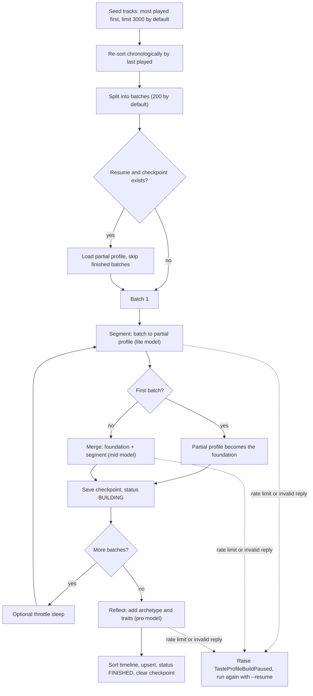

# LLM pipeline

Four components use a language model or its output, and each sits behind a port so the use cases never see a vendor SDK, a prompt or a JSON payload:

| Component | Port | Where | Job |
|---|---|---|---|
| Profiler | `TasteProfilerPort` | `adapters/profilers/gemini/` | Condense a listening history into a structured taste profile |
| Advisor | `AdvisorPort` | `adapters/advisors/gemini/` | Propose tracks the user does not know, guided by the profile |
| Reconciler | none (domain service) | `domain/services/reconciler.py` | Match free-text suggestions to real catalogue tracks |
| Enricher | `TrackEnricherPort` | `adapters/enrichers/gemini/` | Tag tracks with genres, moods and language |

A design stance runs through all of them: **the model proposes, deterministic code disposes.** Output is constrained by a JSON response schema, validated by Pydantic, restricted to closed vocabularies, matched against the real catalogue, and filtered against what the user already knows or has blacklisted. The model never writes to the database or to the provider directly.

## Model choice per step

Models are plain settings ([`museflow/infrastructure/config/settings/gemini.py`](https://github.com/ychab/museflow/blob/main/museflow/infrastructure/config/settings/gemini.py)), overridable with `GEMINI_*` environment variables, so a step can be re-pointed at another model without a code change. Current defaults:

| Step | Setting | Default model | Volume | Why this tier |
|---|---|---|---|---|
| Profile segment | `PROFILER_SEGMENT_MODEL` | `gemini-2.5-flash-lite` | One call per batch (15 for the default 3,000 seeds in batches of 200) | High volume, narrow task: classify a batch of tracks into tags and weights against a closed vocabulary. A small, cheap model is enough |
| Profile merge | `PROFILER_MERGE_MODEL` | `gemini-3.5-flash` | One call per batch after the first | Needs to follow arithmetic and structural rules over a growing JSON document without drifting. A step up from the lite tier |
| Profile reflect | `PROFILER_REFLECT_MODEL` | `gemini-3.1-pro-preview` | **One call per build** | The only step that writes narrative and judgement (archetype, life-phase insights, behavioural traits). Run once, so the most capable model is affordable |
| Advisor | `ADVISOR_MODEL` | `gemini-2.5-flash` | Up to `--max-attempts` calls per playlist (default 3) | Needs musical knowledge and instruction-following, called interactively |
| Enricher | `ENRICHER_MODEL` | `gemini-2.5-flash-lite` | One call per batch of 200 tracks | Pure classification into closed vocabularies, repeated over the whole library |

The principle is to spend model capability where one call has outsized influence on the result (the single reflection pass, the merge that every later step builds on) and use the cheapest tier where the work is high-volume and constrained. Gemini was chosen by the author for its cost-to-context ratio; the models were not benchmarked against alternatives, so treat the tiering as a reasoned default, not a measured optimum.

!!! note "Defaults versus `.env.example`"
    The commented-out examples in [`.env.example`](https://github.com/ychab/museflow/blob/main/.env.example) still list older models for the merge and reflect steps (`gemini-2.5-flash`, `gemini-2.5-pro-preview`). The table above reflects the defaults in code.

## Profiler: batches, merge, reflect



Source: [`taste_profile_build.py`](https://github.com/ychab/museflow/blob/main/museflow/application/use_cases/taste_profile_build.py) (orchestration) and [`profilers/gemini/client.py`](https://github.com/ychab/museflow/blob/main/museflow/infrastructure/adapters/profilers/gemini/client.py) (prompts).

Design decisions:

- **Map, then fold, then reflect.** A 3,000-track history does not fit comfortably in one prompt and a single huge prompt is fragile. Each batch is summarised independently (segment), then folded into a running profile (merge). The final reflection sees only the profile, never raw tracks.
- **Chronological batches.** Seeds are selected by play count (best signal) and then re-sorted by last-played date, so each batch covers a coherent period and the model can describe it as a "taste era" with a time range.
- **Merge rules are explicit in the prompt**, not left to the model: if a new segment is more than 80% similar to the last era it extends that era's end date, otherwise it adds an era; the timeline is capped at 15 eras by merging the oldest; `core_identity` is a weighted average (foundation 0.7, segment 0.3); `current_vibe` is replaced wholesale. The weights encode a product opinion: long-term identity moves slowly, current mood does not.
- **User ratings are part of the signal.** Each track line carries first / last played, play count and, if rated, the score. The prompt tells the model to treat high scores as confirmed anchors and minimum scores as anti-preferences.
- **Checkpoint and pause.** After every batch the partial profile and batch index are persisted ([Data model](data-model.md#taste-profile)). A rate-limit overrun or an unusable reply raises `TasteProfileBuildPausedException` instead of losing the run; `taste build --resume` continues from the next batch. `TASTE_PROFILE_BUILD_THROTTLING_SLEEP_SECONDS` can space out batches to stay under a quota.
- **The reflect step is resumable.** The reflection result itself is not checkpointed, but the merged profile is saved after the last batch. A rate-limit overrun or unusable reply in the final call also raises `TasteProfileBuildPausedException` (reported as batch N/N), and `--resume` skips every batch and repeats only that final call.
- **Reproducibility metadata.** `logic_version` (currently `v1.0`) and the model names used are stored with the profile.

## Advisor: guided discovery

`get_discovery_strategy` returns a `DiscoveryTasteStrategy`: a reasoning paragraph, a strategy label, a list of recommended tracks each with a confidence score, 2 to 3 free-text search queries, and a playlist name. The prompt is assembled in [`advisors/gemini/client.py`](https://github.com/ychab/museflow/blob/main/museflow/infrastructure/adapters/advisors/gemini/client.py) from:

| Input | Source | Purpose |
|---|---|---|
| Profile summaries | Archetype, core identity, current vibe, behavioural traits and era timeline rendered by pure helpers in `domain/utils/taste.py` | Who the listener is |
| Risk calibration | Derived from the `openness` and `adventurousness` traits: both below 0.4 means stay in the comfort zone, either above 0.7 means push into adjacent territory | How far to stray |
| Focus strategy | `expansion`, `roots_revival` or `cultural_bridge`; the last two interpolate the oldest and current era labels from the profile | What kind of discovery |
| Genre and mood hints, custom instructions | Optional CLI flags | Per-session steering |
| Exclusion list | Everything suggested in earlier attempts of the same run | Avoid repeats across attempts |
| Blacklist | Blacklisted artists and tracks | Hard "never suggest" |
| Liked tracks | Tracks rated 7 or more, at most 200 | Concrete taste anchors beyond statistics |

**Quality over quantity** is stated in the prompt: only return a track if confidence would be at least 0.7, and return fewer than the requested limit rather than pad. This is an instruction to the model, not a post-filter in code; the confidence values are used afterwards for ranking. The strategy response is schema-constrained (`responseSchema` with required fields) and validated into Pydantic models.

## Reconciler: from suggestion to catalogue track

An LLM suggests *names*; the provider needs *ids*. For each suggestion the use case searches the provider (`--reconciler-limit` candidates) and asks the `Reconciler` to pick the best candidate:

1. Normalise suggestion and candidate (`normalize_text`: ASCII fold, lowercase, strip feature / remaster / live suffixes).
2. Score the track name with `token_sort_ratio` and the artist with `WRatio` (RapidFuzz).
3. If either component is below `RECONCILER_MATCH_THRESHOLD` (80), the candidate scores 0.
4. Otherwise the composite is `0.6 * track + 0.4 * artist`. A candidate scoring 0 is never accepted, so scores are either 0 or between the threshold and 100. The best non-zero candidate is accepted and its score divided by 100 becomes the **match confidence**.

Two scores therefore travel with each track: the advisor's confidence ("is this a good pick for the listener?") and the reconciler's confidence ("is this the track the advisor meant?"). The final order uses both: advisor score rounded down to a band of 0.05, then match confidence inside the band, so a marginally higher advisor score cannot outrank a clearly more certain catalogue match. A per-artist cap (`--max-tracks-per-artist`, default 3) is applied after sorting so one artist cannot dominate a playlist.

Fuzzy matching is deliberately a domain service: it is pure, deterministic and cheap to test with table-driven cases, and it is the guard against the most visible LLM failure mode, a plausible-sounding track that does not exist.

## Enricher: closed vocabularies

Given title and primary artist (nothing else), the enricher returns 2 to 3 genres ordered macro to micro, 1 to 2 moods, and the list of 2-letter language codes of the *lyrics* (`locales`, several when the lyrics mix languages, empty for an instrumental or when no signal is reliable) (the prompt explicitly separates lyrics language from artist nationality and lists script and title-vocabulary signals). The prompt lists the allowed values for each field, and the response schema constrains genres and moods to those values with enums; the response is validated and then **unknown values are dropped** rather than rejected: genres and moods not in `GenreTag` / `MoodTag` are filtered out, and a locale code that is not two letters is dropped from `locales` (duplicates are removed); if every returned code is invalid, `locales` stays `NULL` so the track remains eligible. A track is never written with an empty genres or moods list: the use case skips that field and logs a warning, so the track stays eligible. Dropping keeps a batch usable when the model invents one tag, at the cost of occasionally storing a shorter list. The field set is selectable (`genre`, `mood`, `locale`; the last one fills `locales`) and `--force` re-enriches already-tagged tracks, which is how a taxonomy change is rolled out. The profiler applies the same restriction to the profile: identity keys outside the vocabulary are removed during validation, and mood values are filtered per era.

## Resilience

Three independent layers, each handling a different failure class:

| Failure | Layer | Behaviour |
|---|---|---|
| Network error, HTTP 5xx, HTTP 429 | `tenacity` `@retry` on `make_api_call` | Exponential backoff (2 s to 60 s). The advisor and profiler stop after `GEMINI_HTTP_MAX_RETRIES` (10) attempts; the enricher inherits the generic `HttpClientMixin` policy (`MUSEFLOW_HTTP_MAX_RETRIES`, 5). A predicate, `_is_retryable_error`, explicitly returns `False` for everything else, including the "rate limit exhausted" domain exceptions, so they propagate instead of looping |
| Rate limit with a server-provided delay | Delay-aware wait (advisor, profiler, Spotify) | The 429 body carries a `retryDelay` (Gemini) or a `Retry-After` header (Spotify). If it is within `HTTP_MAX_RETRY_WAIT` (120 s for Gemini, 60 s for Spotify) the adapter sleeps that long and signals a retry; if it is longer the adapter aborts with a domain `RateLimitExceeded` subclass. The cap prevents a command from silently sleeping for hours. The enricher does not parse `retryDelay`; it relies on plain backoff |
| Structurally invalid reply (bad JSON, schema violation) | `@self_heal` | Re-sends the conversation extended with the model's bad answer and the validation error, asking for corrected JSON |
| Truncated, empty or blocked reply | `@validate_response` | Fails fast with a typed `GeminiResponseError` (`truncated`, `empty_response`, `no_candidates`); not retried, because showing the model its own error cannot fix them |

`RateLimitRetry` is a plain exception, not tenacity's `TryAgain`, because tenacity 9.2 unwraps an exhausted `TryAgain` into its cause, which would bypass the conversion to the domain exception (documented in [`http.py`](https://github.com/ychab/museflow/blob/main/museflow/infrastructure/adapters/http.py)).

### Self-healing structured output

```python
@self_heal()
@validate_response(GeminiDiscoveryStrategyContent, adapter="advisor")
async def _request_discovery_strategy(self, contents, system_prompt) -> dict[str, Any]:
    ...
```

`@validate_response` turns the raw HTTP body into a Pydantic model or raises `GeminiResponseError` with a failure kind. `@self_heal` ([source](https://github.com/ychab/museflow/blob/main/museflow/infrastructure/adapters/common/gemini/self_heal.py)) wraps it: on a self-healable failure it appends two turns to the conversation, the model's own invalid text and a user message `Your previous response is invalid: <detail>. Return only the corrected JSON conforming to the schema.`, and calls again, for at most `GEMINI_VALIDATION_MAX_RETRIES` extra attempts (default 2, so up to 3 calls). Exhaustion logs an error and re-raises. A recovery logs a warning so the rate of invalid replies stays observable.

It is a decorator, in the spirit of tenacity's `@retry`, because the same behaviour is needed by three adapters and a closure copied into each would drift (a project rule, see [Architecture](architecture.md#conventions-and-why-they-exist)). Removing the decorator disables the behaviour with no other change. It was introduced in commit `a8ad2dc`.

Failure surfaces differ by component, on purpose: the advisor and profiler translate a final failure into a domain exception (`DiscoveryTasteStrategyException`, `TasteProfileBuildException`) that the CLI reports or turns into a pause; the enricher logs and returns an empty result for that batch so one bad batch does not abort a long enrichment run.
