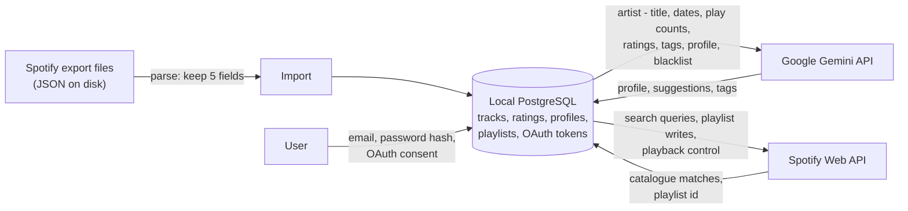

# Privacy & data

MuseFlow handles a sensitive dataset: years of listening behaviour. This page states what is stored, what is discarded, what leaves the machine, and where the design falls short. It is a description of the code as it stands, not a compliance statement.

Everything runs on the user's own machine; the only outbound traffic is to the two APIs above. There is no MuseFlow-operated server and no telemetry.

## What is stored locally

| Data | Where | Notes |
|---|---|---|
| Tracks: name, artists, album, provider id, aggregated play stats, rating, tags | `museflow_track` | One row per track, not per play ([Data model](data-model.md)) |
| Taste profiles | `museflow_taste_profile` | LLM-generated JSON, including a narrative summary of the listener |
| Playlists and membership | `museflow_playlist`, `museflow_playlist_track` | Includes the reasoning and custom instructions used |
| Blacklist | `museflow_blacklisted_*` | Artists and tracks the user excluded |
| User | `museflow_user` | Email and Argon2 password hash |
| Spotify OAuth tokens | `museflow_auth_token` | Access and refresh token |
| Raw export files | Wherever the user keeps them | MuseFlow reads them, never copies or modifies them |

## What is dropped at import

A Spotify extended streaming-history export contains much more than listening data. Each entry carries fields such as `ip_addr`, `conn_country`, `platform`, `reason_start`, `reason_end`, `shuffle`, `skipped`, `offline`, `incognito_mode`, and episode and audiobook fields. The importer ([`providers/spotify/history.py`](https://github.com/ychab/museflow/blob/main/museflow/infrastructure/adapters/providers/spotify/history.py)) reads only:

| Kept | Used for |
|---|---|
| `ts` | Play timestamp, aggregated into first / last played |
| `ms_played` | Only to apply the minimum-duration filter; not stored |
| `spotify_track_uri` | Track id (entries without a valid `spotify:track:` URI are skipped, which also drops podcast episodes and audiobooks) |
| `master_metadata_track_name` | Track name |
| `master_metadata_album_artist_name` | Artist |
| `master_metadata_album_album_name` | Album |

IP address, country, device platform and playback behaviour are never read into the application's data structures (`StreamingHistoryEntry` has five fields), so they cannot reach the database, a prompt or a log. Individual play timestamps are reduced to a count plus first and last timestamp per track.

## What leaves the machine

### To Google Gemini

Requests are authenticated with an API key sent in the `x-goog-api-key` header. No user id, email, IP address or Spotify identifier appears in any prompt builder (`advisors`, `profilers` and `enrichers` under `museflow/infrastructure/adapters/`).

| Call | Content sent |
|---|---|
| Profile segment | Up to `--track-limit` tracks (default 3,000), one line each: first-played date, last-played date, play count, rating if any, artists and title |
| Profile merge, reflect | The profile JSON built so far (tags, weights, eras, traits) |
| Advisor | Text summaries derived from the profile, up to 200 highly rated tracks (artist and title), the exclusion list for the session, blacklisted artists and tracks, and any `--genre`, `--mood` and `--custom-instructions` the user typed |
| Enricher | A list of `{index, title, primary_artist}` |

Two properties to be aware of. First, the listening history itself is sent (as artist-and-title lines with dates), because that is the input the profile is built from; a taste profile is also a behavioural summary of its owner. Second, `--custom-instructions` is free text forwarded verbatim, so what the user writes there leaves the machine too.

### To Spotify

| Interaction | Content |
|---|---|
| OAuth | Client id and secret, authorisation code exchange, token refresh. Scopes requested: `playlist-modify-public`, `playlist-modify-private`, `user-modify-playback-state`, `user-library-modify` |
| Search | `track:"..." artist:"..."` queries built from LLM suggestions |
| Playlist writes | Create a playlist (private by default, description `Auto-generated by museflow`), add tracks in batches of 100, delete a playlist |
| Playback | Start a track on the user's active device (used by the interactive rating command) |

The listening history is **not** read from Spotify's API; it comes only from the export file. No read scope on the user profile or email is requested.

## Secrets handling

- Configuration comes from environment variables and an optional `.env`, loaded by `pydantic-settings` (`SPOTIFY_*`, `GEMINI_*`, `DATABASE_*`, `MUSEFLOW_*`). `.env` is git-ignored; `.env.example` holds placeholders. `MUSEFLOW_SECRET_KEY` (JWT signing) must be at least 32 characters.
- Passwords are hashed with Argon2. OAuth `state` values come from `random.SystemRandom` and are single-use.
- Logging policy forbids secrets (tokens, passwords, API keys); logs carry user ids, not emails. A grep of the logging calls finds no token or key being logged. This is enforced by convention and review, not by a redaction layer.
- The tests use dummy credentials set in `pyproject.toml`; WireMock stands in for both APIs, so the test suite never sends real data anywhere.

## Known gaps

!!! warning "Stated plainly"
    These are real limitations of the current implementation. None is hidden by the design; each is a conscious scope decision for a single-user showcase project, and each would need work before a hosted, multi-user service.

1. **Email is the user identifier.** The CLI selects a user by `--email`, and email is stored in clear in `museflow_user`. It is never sent to Gemini or Spotify, but it is the key people type into shell history. A random handle or the internal UUID would be a better key.
2. **Gemini free tier.** On Google's free API tier, Google may use submitted prompts to improve its products; the paid tier does not. Because prompts contain listening history and the profile, this is a meaningful difference. Which tier is used is a property of the API key, not of the code, and nothing in MuseFlow detects or warns about it.
3. **OAuth tokens are stored unencrypted** in `museflow_auth_token` and the database has no application-level encryption. The assumption is a local, single-user database. The `spotify info` command prints the stored token to the terminal.
4. **No retention policy.** Data stays until deleted by hand. The CLI provides deletes (`tracks delete`, `playlist delete`, `blacklist remove` / `purge`). Foreign keys cascade from the user row, but no CLI command deletes a user, nothing expires data, and there is no single "erase everything about me" command.
5. **Commands commit step by step, not as one transaction.** Each repository method commits on its own, deliberately: most flows (profile build, enrichment, history import, rating import) produce a partial state that is incomplete but valid, and keeping that progress (often paid LLM work) beats rolling it back; a re-run completes it. Remote side effects run first: `playlist discover` creates the Spotify playlist before writing anything locally, so a provider failure leaves no trace. What remains: a database failure right after a remote call leaves an orphan remote playlist (or, for `playlist delete --remote`, a local row whose remote playlist is gone), and a failure between the discovery tracks upsert and the playlist save leaves delivered tracks without their local playlist (they can still be rated). A purge of orphans, or a unit of work grouping the local writes of `discover`, are possible follow-ups.
6. **Fixtures should be synthetic.** Sample export files under `tests/assets/history/` mirror the real export layout, including `ip_addr`. Some values in them are not obvious placeholders; test data in a public repository should be fully synthetic.
