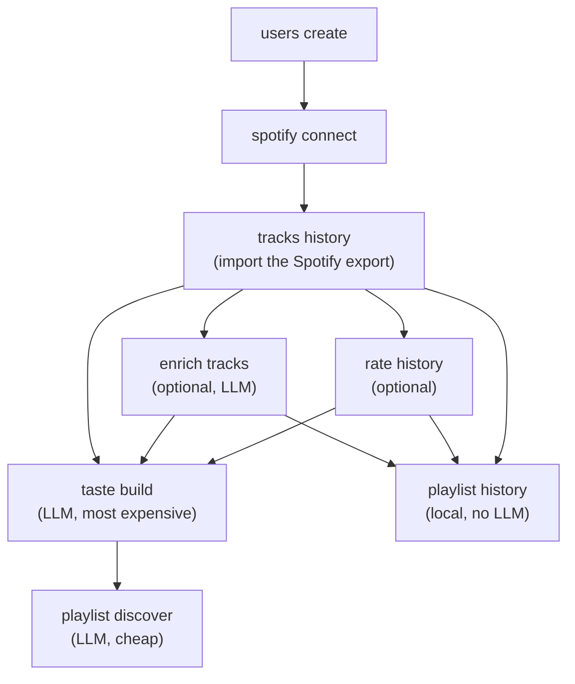

# Getting started

This page walks through the path from an empty install to a first playlist. Every step is a single
`museflow` command; the full option reference lives in the [command pages](commands/users.md).

## Prerequisites

- MuseFlow installed and configured as described in the
  [README installation section](https://github.com/ychab/museflow#installation) (database, Spotify
  application credentials, settings).
- The API server running (`make run` or `make up`) when connecting a Spotify account: the OAuth callback is
  received by the API, and the CLI waits for it.
- A Gemini API key configured, for the steps that call an LLM (`enrich tracks`, `taste build`,
  `playlist discover`).
- Your Spotify **Extended streaming history**, see [Spotify data export](spotify-data-export.md).

The CLI is available as `museflow` when installed in the environment, or as `uv run museflow` from the
repository. Every command takes `--email` to select the user. Run `museflow --help` or
`museflow <group> <command> --help` at any time.

## The flow



### 1. Create a user

```bash
museflow users create --email user@example.com
```

The password is prompted for (hidden, with confirmation). See [`users`](commands/users.md).

### 2. Connect Spotify

```bash
museflow spotify connect --email user@example.com
```

A browser window opens on the Spotify consent page; the command waits until the callback has been processed
by the API server. See [`spotify`](commands/spotify.md).

### 3. Import the streaming history

Request the export first ([Spotify data export](spotify-data-export.md)), unzip it, then:

```bash
museflow tracks history --email user@example.com --directory ~/Downloads/MySpotifyData
```

Short plays are ignored (90 seconds by default), and tracks are stored with their play count and first/last
played dates. See [`tracks`](commands/tracks.md).

### 4. Rate tracks (optional)

```bash
museflow rate history --email user@example.com --play
```

Scores from 0 to 10 are an explicit preference signal, on top of the play counts. They are used by
`taste build --rated-only`, by `playlist history --score-min`, and by the [`stats`](commands/stats.md)
commands. See [`rate`](commands/rate.md).

### 5. Enrich tracks (optional)

```bash
museflow enrich tracks --email user@example.com
```

Adds genre, mood and language metadata to tracks with an LLM. Required for the `--genre`, `--mood` and
`--locale` filters of `playlist history`. See [`enrich`](commands/enrich.md).

### 6. Build a taste profile

```bash
museflow taste build --email user@example.com --name my-profile
```

Analyses the library with Gemini and stores a master taste profile (eras, personality archetype, life-phase
insights). Add `--rated-only` when enough tracks have been rated. See [`taste`](commands/taste.md).

### 7. Discover a playlist

```bash
museflow playlist discover --email user@example.com
```

Asks the advisor for new tracks guided by the profile, matches them on Spotify, and creates a playlist.
Add `--dry-run` to preview the result without creating anything. See [`playlist`](commands/playlist.md).

## The rediscovery path (no LLM call)

A playlist can also be built from the library itself, filtered and ordered by play count or score:

```bash
museflow playlist history --email user@example.com --played-last-max 2023-12-31 --limit 30
```

This needs only steps 1 to 3 (a connected Spotify account is required to create the playlist). See the
[recipes](recipes.md) for more.

## What costs money

| Command | Calls an LLM | Notes |
| --- | --- | --- |
| `enrich tracks` | Yes | One request per batch of tracks (`--batch-size`). Use `--limit` to cap it. |
| `taste build` | Yes | The most expensive step: processes up to `--track-limit` tracks in batches. Use `--resume` after an interruption. |
| `playlist discover` | Yes | A few small advisor calls (`--max-attempts`). Use `--dry-run` to avoid creating a playlist. |
| everything else | No | `playlist history`, `rate`, `stats`, `blacklist`, exports and imports run locally. |

!!! tip
    `enrich export` / `taste export` / `rate export` save LLM results and ratings to YAML, so a database reset
    does not mean paying again. See [Back up and restore](recipes.md#back-up-and-restore-ratings-enrichment-and-taste-profiles).
